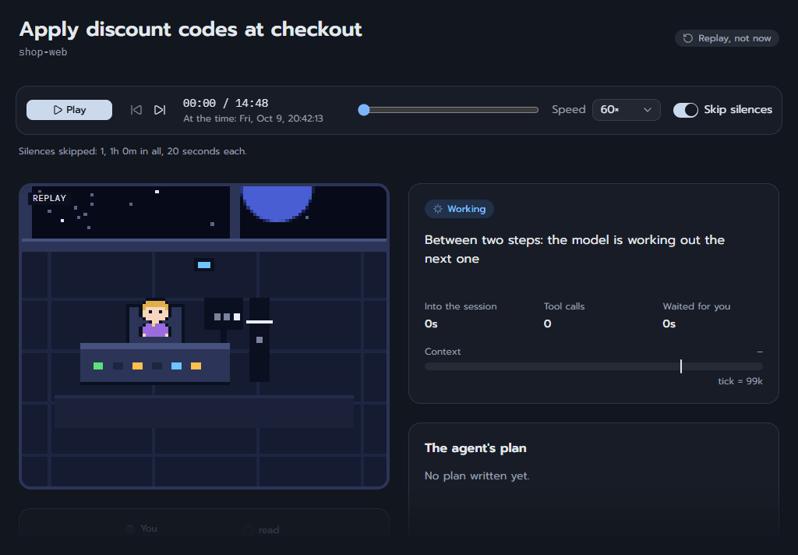
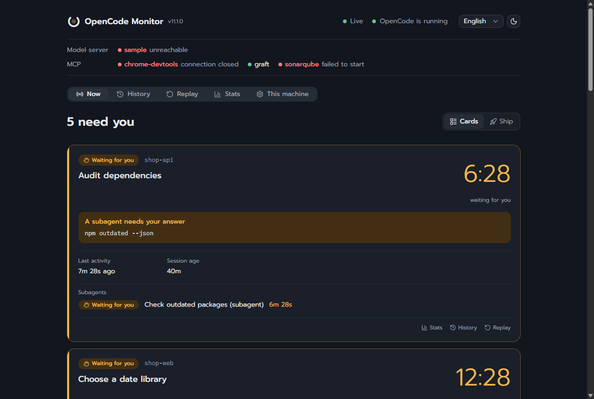
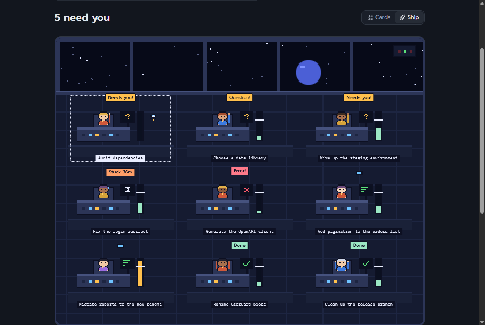
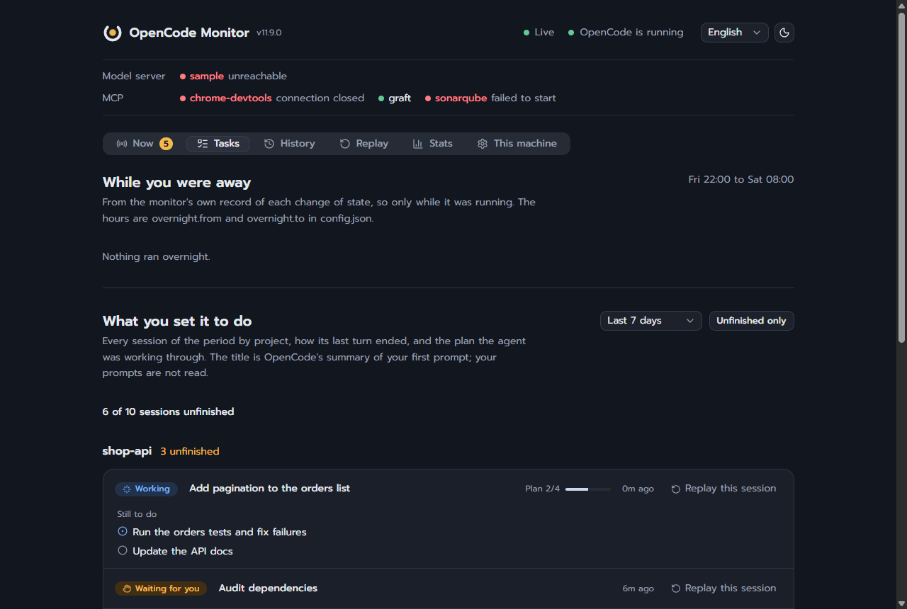
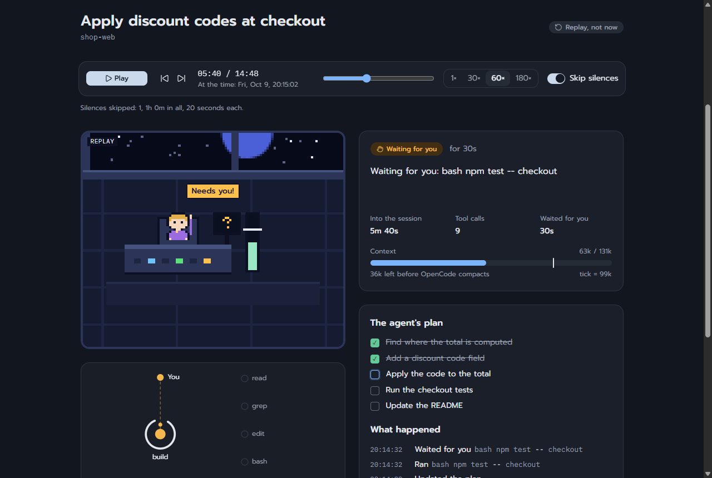
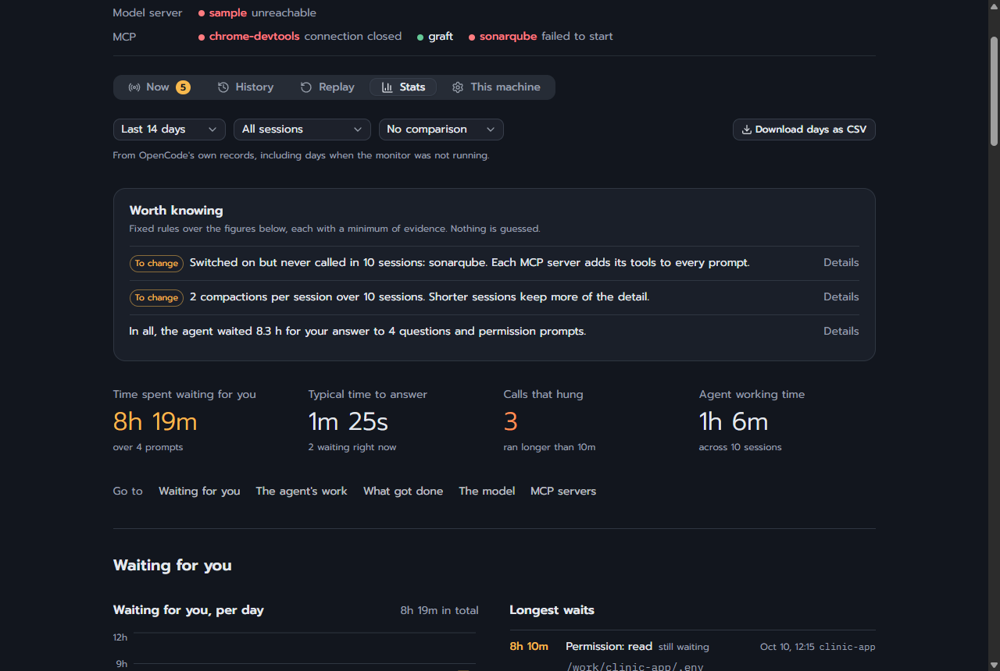
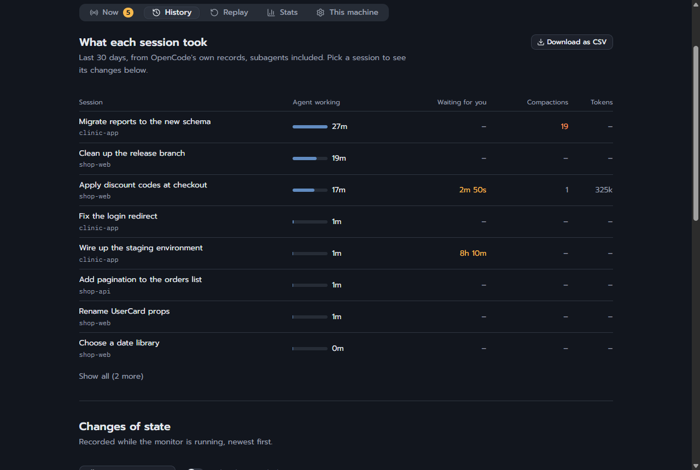
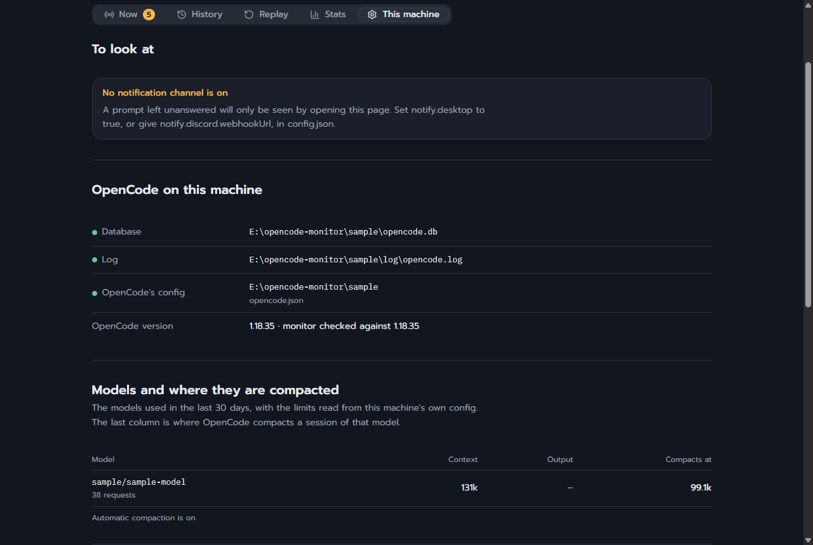

# opencode-monitor

**English** · [ไทย](README.th.md)

A local status page for [OpenCode](https://opencode.ai). It answers one question at a glance: is the agent **working**, **waiting for you**, **probably stuck**, **finished**, or **failed**? Around that it keeps what you need to come back to the work: what each session was set to do and how far it got, what happened overnight, what the model server is doing, and figures on where the time and the tokens went.

It exists because of things like a permission prompt sitting unanswered for eight hours overnight while it looked like the agent was busy.

- **Read-only.** It reads what OpenCode already stores on disk and changes nothing in OpenCode. For OpenCode 2 it also asks OpenCode one thing, which is stored nowhere: what a session is waiting for you to allow.
- **Local.** Binds to `127.0.0.1` only, unless you open it to your own network with `--lan`, where every other device must show an access key. No telemetry. Nothing leaves your machine unless you configure a Discord webhook.
- **No install step.** The server uses built-in Node modules only, and the page comes pre-built. npm is needed only to change the page (see [dashboard/](dashboard/README.md)).
- **Secrets are hidden by default** before anything is displayed or sent.

> **Contributions are not accepted.** Pull requests are closed without review and feature requests are not taken. Bug reports are welcome as issues. You are free to fork and change your own copy (MIT). Details: [CONTRIBUTING.md](CONTRIBUTING.md).

## Contents

- [Features](#features)
- [What it looks like](#what-it-looks-like)
- [Getting started](#getting-started): requirements, running it, options, keeping it running, the app, your local network
- Using it: [the Now tab](#now-tab), [the status strip](#status-strip), [what the agent did](#agent-did), [Tasks](#tasks), [History](#history), [Replay](#replay), [Stats](#stats), [This machine](#this-machine)
- [Ask Claude about it](#mcp): the MCP server, also from another machine
- [Settings](#settings) and [Discord](#discord)
- [Where the data comes from](#data), and the files the monitor writes
- [Troubleshooting](#troubleshooting)
- [Limits](#limits)
- [Development](#development): layout, tests, code quality, releases
- [Contributing](#contributing) · [Not affiliated with OpenCode](#not-affiliated) · [License](#license)

<a id="features"></a>

## Features

- **What needs you first.** Every session's state, with what it waits for and since when; desktop and Discord notifications when one waits, hangs, fails, goes round in circles, or OpenCode gives up on an unanswered prompt. [The Now tab](#now-tab)
- **What the model is doing.** While a session waits on a llama.cpp server, how many tokens of the prompt it has read and how fast, or how much it has written; and a warning when the server works on nothing. [The Now tab](#now-tab)
- **What you set it to do.** Every session of the last days by project, how it ended, and what is left of its plan; and a report of the night: what ran while you were away, and for how long nothing did. [Tasks](#tasks)
- **What it depends on.** The model server (and what it really has loaded), MCP servers, and services of your own. [The status strip](#status-strip)
- **What it did.** Files touched, the branch, processes left running, and tool calls worth a second look. [What the agent did](#agent-did)
- **Where the time went.** Waits, hangs, tools, MCP servers, model speed, tokens and cost, compactions, prompts read again, and a few sentences on what is worth changing. [Stats](#stats)
- **What it cost.** For a model you pay for: each day and month, by model and session, where the month heads, and a notification at the budget you set. [Stats](#stats)
- **Looking back.** Every change of state, and any session played back moment by moment, or a whole day at once. [History](#history), [Replay](#replay)
- **Asking about it.** The same figures for Claude Code over MCP, on this machine or from another. [Ask Claude about it](#mcp)

<a id="what-it-looks-like"></a>

## What it looks like



**Replay** · a session played back from OpenCode's own records: the agent works, waits for you, runs out of room and compacts, and finishes.

| | |
| --- | --- |
| <br>**Now** · what needs you first, with how long it has waited | <br>**Ship** · the same sessions as a live pixel-art bridge |
| <br>**Tasks** · what you set it to do, and the night while you were away | <br>**Replay** · one session played back, moment by moment |
| <br>**Stats** · what the figures add up to, then the figures | <br>**History** · what each session took, and every change of state |
| <br>**This machine** · what was found here, and what is missing | |

The pictures are of `node server.mjs --sample`, made-up data: run that to try every tab without OpenCode. If the monitor is useful to you, a star on GitHub helps others find it.

<a id="getting-started"></a>

## Getting started

### Requirements

- Node.js 22.13 or newer.
- OpenCode 1.x or 2 on the same machine (its data directory, `~/.local/share/opencode` by default). Not needed for `--sample`.
- Optional: a Discord webhook for notifications, a llama.cpp model server to see what it runs, Claude Code to ask about the figures.

### Install and run

```sh
git clone https://github.com/adcident12/opencode-monitor.git
cd opencode-monitor
node server.mjs
```

Open <http://127.0.0.1:4317>.

To see it without OpenCode, run it on generated fake data:

```sh
node server.mjs --sample
```

### Command-line options

| Option | Meaning |
| --- | --- |
| `--port <n>` | Port to listen on (default 4317) |
| `--data-dir <path>` | OpenCode data directory, the one holding `opencode.db` |
| `--config <path>` | Settings file (default `config.json` next to `server.mjs`) |
| `--lang <code>` | Language for notifications (`en`, `th`) |
| `--sample` | Use generated fake data |
| `--no-notify` | No desktop or Discord notifications |
| `--lan` | Also answer the other devices of your local network, each with the access key (see "Open it to your local network" below) |
| `--access-key` | Print the addresses to open on another device, with the key, and the command for Claude Code on another machine, then exit |
| `--assume-running` | Skip the check for a live OpenCode process |
| `--version` | Print the version, then exit |
| `--doctor` | Print what the monitor finds on this machine, and what is missing, then exit |
| `--test-notify` | Send one sample of every kind of notification that is on (`notify.on`), on each channel, and print how each was received |
| `--autostart on` / `off` | Start the monitor each time you log in, or stop doing so, then exit |

### Keep it running

The monitor is only useful while it runs, and a prompt left unanswered overnight is exactly when a forgotten terminal has been closed. On Windows:

```sh
node server.mjs --autostart on
```

registers a scheduled task named `opencode-monitor` for your user (no administrator rights needed) that starts the monitor at each login, without a console window. Options given with it (`--port`, `--data-dir`, `--config`, `--lang`, `--no-notify`) are kept. `schtasks /Run /TN opencode-monitor` starts it right away, and `node server.mjs --autostart off` removes the task. The task points at this folder and at the Node you ran it with, so run it again after moving either.

On macOS the same command writes a launchd agent to `~/Library/LaunchAgents/com.opencode-monitor.plist` (output goes to `~/Library/Logs/opencode-monitor.log`), and on Linux a systemd user unit to `~/.config/systemd/user/opencode-monitor.service`; both start the monitor at once and at every login, and `--autostart off` removes them. On all three systems CI does this for real on every push: it turns autostart on, waits for the monitor that the system started to answer, turns it off, and checks that it is gone. What CI cannot show is a desktop login after a reboot; if the monitor is not there after you log in, `--doctor` and the system's own log (`journalctl --user -u opencode-monitor`, or `~/Library/Logs/opencode-monitor.log`) say why.

### Install it as an app

In Chrome or Edge, **Install app** at the top of the page puts the monitor in a window of its own, with its own icon on the taskbar and in the Start menu, instead of a browser tab. The button is there only while the browser offers to install, so it is gone once that is done; other browsers do not offer it (Safari has **Add to Dock** in its File menu).

The app is still this page, served by the monitor on this machine: nothing is copied anywhere, and it shows data only while the monitor runs, so it goes well with `--autostart on`. It is installed for the address it was opened at, so keep to one port. To remove it, use the app window's menu (**Uninstall**).

### Open it to your local network

By default the monitor answers this machine and nothing else. To look at it from a phone or another computer on the same network, start it with `--lan` (or set `"lan": true` in `config.json`):

```sh
node server.mjs --lan
node server.mjs --access-key
```

The second command prints the address to open on the other device, with the access key in it. Open it once: the device is then remembered for a year by a cookie, and the key is taken out of the address it is left at. A device that comes without the key is shown a page that asks for it, and gets nothing else: not the page, not the figures, not the live updates.

- The page shows commands, paths and what you asked the agent, with secrets hidden as everywhere else. Anyone with the key sees all of it, so give it only to devices of your own, and only on a network you trust. It is still read-only: nothing can be changed or run through it.
- The key is 32 random characters kept in `data/access-key`, readable by you only. It is printed only when you ask with `--access-key`, never at startup, so it does not end up in a log. Delete the file and start the monitor again for a new one; every device must then ask again.
- This machine never needs the key, and a request that arrives under any name other than this machine's own addresses is refused. A link-local address (169.254.x.x) is not one of them.
- The connection is plain `http`, as it is on `127.0.0.1`: on a network others can listen to, they could read it. The monitor does not open your router or reach the internet; your firewall may ask whether to let Node accept connections the first time.
- **Install app** works on this machine only: browsers install from `http` at `127.0.0.1`, not at a network address.

<a id="now-tab"></a>

## The Now tab

### What the states mean

| State | How it is decided |
| --- | --- |
| Waiting for you | A `question` tool call is open, or a permission prompt was logged for a tool call that has not moved since. Subagent prompts show on the parent session too. |
| Probably stuck | One tool call has run longer than `stuckToolMinutes`, or nothing at all has happened for `silentMinutes` while the model owes a reply. |
| Error | The last model request failed, or the reply hit the output token limit. |
| Working | A tool is running, or the model is producing the next step. |
| Finished | The agent ended its turn normally. |
| Idle | No messages yet, stopped by the user, OpenCode was closed mid-task, or OpenCode stopped waiting for an answer nobody gave. |

A failed tool call alone is not an error state, because agents normally recover from those. Failed calls are counted under session health instead.

For a session that is still going, the page also shows how far it has got:

- the running command, the last lines it printed, and how long ago the last line arrived. "Running for 35 minutes, last output 34 minutes ago" is what a hung command looks like;
- when anything at all last happened in the session;
- the latest tool calls of the current turn with their result and duration;
- the agent's own plan, done of total, with the item in progress; a finished session whose plan was left part done keeps showing how far it got;
- **what the model server is doing for it**, from a llama.cpp server's slots (asked every three seconds while a session waits on its model): reading the prompt, with how many tokens so far and how fast; writing, with how many tokens and how fast; or working on no request at all for a minute, which is the server and not the agent. llama.cpp does not say how long a prompt is until it has read it all, so no share and no time left is given. It is shown only when one session waits on that server, since which slot serves which is not known.

OpenCode stores a model reply only when it starts and when it ends, so the text being written is never shown; with a llama.cpp server, its slots say how much of it there is so far.

Each session also shows its health: context used against the model's limit, number of compactions, session age, failed tool calls, and whether the same command keeps repeating. When the agent is going round in circles it says so, and with `"loop"` in `notify.on` (on by default) you are told once each time it starts: the same calls back to back (one call 8 times, or two or three in turn 6 times), one tool failing 4 times with no success of it in between while the agent keeps trying, or an hour of work and 30 calls without its plan (the todo list) changing while items are open. The context bar has a tick where OpenCode will compact the session. Nothing about that point is fixed in the monitor: it is worked out for each session with the rule of the OpenCode that is running it (read from its log), from the limits you set for that model in `opencode.json` (the project's file over the global one).

OpenCode 1.x:

- reply = the smaller of `limit.output` and 32,000 (or `OPENCODE_EXPERIMENTAL_OUTPUT_TOKEN_MAX`)
- a model with `limit.input`: `limit.input` − (`compaction.reserved`, or the smaller of 20,000 and reply)
- any other model: `limit.context` − reply
- `compaction.auto: false`: never, and the card says so

OpenCode 2: the window (`limit.input`, else `limit.context`) less `compaction.buffer`, or less a tenth of the window, at least 16,000; the output limit plays no part.

So with OpenCode 1.x a 32,768 window with 4,096 output compacts at 28,672, and a 131,072 window with 32,768 output at 99,072. Under the bar the page says how many tokens are left before that and, from how much the last few requests grew, roughly how many requests. It warns once the session is 85% of the way there or 3 requests away (`thresholds.compactWarnPct`, `thresholds.compactWarnRequests`). When these look bad the page suggests starting a new session.

### The ship

The same sessions can be seen as the bridge of a spaceship: switch between **Cards** and **Ship** next to the heading of the Now tab, and the choice is remembered in that browser. Each session is a crew member at a console, the ones that need you in the front row; it moves as the cards would change, every two seconds.

- A raised hand and an amber bubble: waiting for you. Sweating, with an hourglass on the screen: probably stuck. A red cross: an error. Arms up: finished. Asleep on the console: idle.
- While it works, the screen shows the tool: green text for a shell, coloured lines for an edit, a page for a read, a globe for the web or an MCP server.
- The gauge beside each console is the context, with a white tick where OpenCode compacts; it turns amber when that is close, and puffs when it has just compacted. Drones beside a station are its subagents at work, and the lights on the wall are the MCP servers.

Pick a station to see that session's card under the picture. Only the project's folder name is written on the bridge, cut short when it does not fit; the full name and everything else are on the card, so a long name never runs into the next station. The bubbles say the state in a word or two and never quote the session. Twelve stations at most: past that, the page says how many are left off and Cards shows them all. On a phone the bridge has two columns. The picture holds still for anyone who has asked their system for less motion. The crew and the ship are drawn in code for this project; no artwork from anyone else is used.

<a id="status-strip"></a>

## The status strip

A strip at the top shows the things the agent depends on:

- **Model server**: providers in OpenCode's config that have their own `baseURL` are asked for `<baseURL>/health` (no credentials sent; any answer below HTTP 500 counts as up, so a server without that address still counts, and one that is still loading its model does not). By default only addresses on this machine or network are checked; set `environment.modelServers` to `"all"` to include others, or `"off"`.
  - **What it really runs.** A llama.cpp server is also asked for its settings (`/props`, every five minutes and when it comes back up): the model it has loaded and the context it was started with. Hover over it to see them. It turns red when a session that is working now asks for another model than the one loaded (the server answers anyway, under the name it was asked for, so OpenCode's figures carry the wrong model), or when OpenCode takes the context to be larger than the server's (a request past it is refused before OpenCode compacts). The model is compared only when the server was started with `--alias`. A server that wants a key gives its settings only with it: name where the key is in `modelServerKeys`, as `"{env:NAME}"` or `"{file:path}"` by OpenCode provider id (`{"local-llama": "{env:LLAMA_API_KEY}"}`); the key itself in `config.json` is refused, so the file can be shared. Only that server is sent it, as OpenCode sends it. A server that refuses (no key, a wrong one, or no `/props`) is asked once each time the monitor starts and not again, so its log does not fill with failed logins.
- **MCP servers**: OpenCode only logs MCP failures, so status is inferred. *Failed* means the running OpenCode logged the server failing, or a tool call found the connection gone, and none of its tools has worked since. *OK* means one of its tools completed. *No signal* means neither. OpenCode 2 also logs each connection, with how many tools the server offered: a server connected by a running OpenCode 2 shows *connected* before any of its tools is used, and a connection after a failure means it is back. One that connected but offered no tools shows *connected, no tools* in grey, not as a failure: some servers offer tools only in a project they were set up for (graft, until it has indexed one). Servers that a project's own `opencode.json` adds or switches on are included for the sessions on screen. Connections that close because OpenCode itself quit are not failures.
- **Services**: anything you list under `services` in `config.json`, by URL or by host and port.

With `notify.environment` on, you are notified once when any of these goes down.

<a id="agent-did"></a>

## What the agent did

Each session card has two fold-out sections.

**Work** shows the files the agent touched and the git branch the project is on. It warns whenever the session is on a protected branch (`main` or `master` by default), whether or not any file change was detected: the file count only covers the edit tools, not changes made through shell commands.

**Still running** lists processes this session started in the background (a dev server via `Start-Process`, `nohup`, `docker compose up -d`) that are still alive, with their PID, the ports they listen on, and the command to stop them yourself. A process is matched to the command that started it by start time (within a minute after it) and shared words, so check the command before stopping anything. The monitor never stops processes. Turn it off with `work.processes: false`.

**To review** is a hint list, not a security control. It lists tool calls worth a second look, with whether you were prompted for it (*you were asked, then it ran*, *allowed by a rule, no prompt*, or *you refused*):

| Kind | Examples |
| --- | --- |
| Risky | commands built at run time that cannot be read (`eval`, encoded or piped-in scripts), recursive delete, killing processes, force push, `git reset --hard`, `DROP TABLE`, `docker system prune`, piping a download into a shell |
| Secret values | a secret-looking value in a command or in a tool result (shown redacted; the original is still in OpenCode's own database) |
| Secret files | reading `.env`, private keys, credential files |
| Outbound | `git push`, publishing, requests to hosts outside your network, `ssh`/`scp` |
| Background | commands that leave a process running (`Start-Process`, `nohup`, `docker compose up -d`) |

These are pattern matches meant to point you at things to check. They do not prove anything happened, and a command phrased unusually will not be caught. OpenCode logs that it asked but not what you answered, so "you were asked" is inferred from a prompt logged at the moment the call started.

If a rule is only noise for you, list it under `review.ignoreRules` in `config.json` (rule names are the `rule.*` keys in `i18n/en.json`, for example `"kill_process"` or `"background"`). Calls flagged by the same rule are shown as one entry with a count and every distinct command in it, so a harmless command cannot cover for a dangerous one under the same rule. Anything cut for length, or left out by `review.ignoreRules`, is counted on the page rather than dropped silently.

<a id="tasks"></a>

## Tasks

With many sessions going, it is easy to lose track of what you set the agent to do and how far each got. The **Tasks** tab lists every session of the last 7, 14 or 30 days by project: its title (the summary OpenCode makes of your first prompt; your prompts are not read), how its last turn ended (working, waiting for you, probably stuck, interrupted, stopped on an error, or handed back to you), and the plan the agent was working through, as done of total with the items still to do. Unfinished sessions come first in each project; "Unfinished only" hides the rest. A session whose agent wrote no plan, as for a small job, says only how it ended.

The plan is the agent's own todo list: OpenCode 1.x keeps it in its database, OpenCode 2 only in the agent's latest `todowrite` call, and both are read.

At the top of the tab, **While you were away** reports the latest night (`overnight.from` to `overnight.to`, 22:00 to 08:00 by default): each session that ran, how long it worked and waited for you, and how it stood at the end with why (waiting for a permission, an error from the model server, OpenCode stopped waiting); and above them, the longest stretch in which nothing ran at all while a session needed you. It is read from the monitor's record of each change of state, so it covers only the hours the monitor was running, and is empty when `history.enabled` is off. With `notify.overnight.enabled` it is also sent to Discord when the night ends (see [Discord](#discord)).

<a id="history"></a>

## History

The **History** tab lists every change of state, newest first: when a session started waiting, how long it had been working before that, what it was running when it got stuck. Above the list, **What each session took** ranks the sessions of the last 30 days by agent working time, with time spent waiting for you, compactions, and tokens, subagents included and taken from OpenCode's own records. Click a session to follow it in the list below. "Download as CSV" saves that table; in Stats, "Download days as CSV" saves the figures per day. The files are built in the page from what it already shows, with titles that look like spreadsheet formulas escaped.

Tick "Only what needed you" to see just the waits, hangs, and errors, or pick one session to follow it from start to finish. The newest 100 entries are shown; "Load older entries" brings the next 100, and new entries keep appearing at the top without moving what is already loaded. Both filters are applied to the whole record, not only to what is on screen.

History is recorded only while the monitor is running, into `data/history.jsonl` (git-ignored, one JSON object per line, already redacted). Entries older than `history.retentionDays` are removed at startup. Set `history.enabled` to `false` to turn it off. Delete the file to clear it.

<a id="replay"></a>

## Replay

The **Replay** tab plays one session back: pick it from the list, or follow **Replay** at the foot of any card, or **Replay this session** in Stats, History and Tasks (`#replay/<session id>`, so it can be bookmarked). It is labelled as a replay throughout, so a raised hand there is never taken for someone waiting now.

- The player has play and pause, a step to what happens next or back, a slider, seven speeds from real speed (1×) to 180×, and the real time of the moment it is at. The time of each entry under **What happened** leads back to that moment, as does a click on the timeline.
- In the picture of the agent and its tools, a dot runs along the line to the tool in use, to you while it waits, and a ring spreads from the agent while it reads, thinks or writes; nothing moves once it has finished. The tools used most have a place each and the rest share one, named while one of them is in use. Played fast, a call of a second would be on screen for a blink, so its line stays for a moment and fades.
- **Skip silences** is on by default: a stretch longer than two minutes where nothing at all happened (you went home, the agent finished and waited) takes 20 seconds of playback, and is marked on the timeline. Turn it off to play real time.
- At each moment: the session's station on the bridge, the panel the Now tab would have shown (its state, what it was doing and for how long, calls so far, time waited for you, and the context against the point where OpenCode compacts), the agent drawn with the tools it reaches for and its subagents as they work, the plan as it stood, and what had happened up to then.
- Under it, a timeline of the session and each subagent: reading the prompt, thinking, writing, tools, compacting, and waiting for you, with every compaction marked. Point at it to see what was happening; click to go there.

It is read from OpenCode's own records with the rules of the Now tab, so it works for a session the monitor never saw, and a session still going grows at the end. What the model wrote is not played back: OpenCode records only when a reply starts and ends, and nothing is made up to fill it. A permission's answer time is inferred, as in Stats, and the plan items, commands and paths shown pass through the same redaction as the rest of the page.

### The whole bridge

**The whole bridge**, at the top of the Replay tab, plays back every session of one day at once: the bridge as it stood at each moment, a station a session, with how many were waiting, stuck, failed, working or finished, a line for each saying what it was doing, and a timeline with a row a session. A day is this machine's own, midnight to midnight; the list offers the last 30 days that had something, with how many sessions each.

- Each session is its own replay, read by the same rules, so a station here and that session played on its own never disagree; a session not begun yet is idle. Click a station, or **Replay** on its line, to play that session on its own.
- A silence is skipped only when no session at all, subagents included, was doing anything. The step buttons go between the turns of the day (prompts, waits and their answers, compactions, the end of a turn), not every tool call.
- Twelve stations at most, as on the live bridge, in the order the sessions began; the rest of the day is counted under the picture. Today grows at its end while the page is open.

<a id="stats"></a>

## Stats

The **Stats** tab looks back over the last 7, 14, or 30 days, from OpenCode's own records, so it covers days when the monitor was not running:

- how long prompts waited for you in total, the typical time to answer, and the longest waits;
- how many tool calls hung (ran longer than `stuckToolMinutes`), and the slowest ones;
- time the agent spent working, per day;
- calls per tool and how many failed, how often graft was used instead of read/grep/glob, files read again and again in one session, and skills loaded;
- one row per **MCP server**: calls, time per call, when it was last used, how often its connection dropped or it failed to start, and its most used tools. Failures are split in two: *failed* is a tool reporting an error (a script with a typo), *no answer* is the server itself not responding (connection closed, request timed out). Servers that are switched on but were never called are named, because each one still adds its tool list to every prompt;
- **where the agent's time went**: reading the prompt before the first token, thinking, writing, and tools running, with a line on which of them takes most and what would shorten it;
- **your prompts**: how many steps and how long each took, and how it ended: answered, continued by your next prompt, cut off at the output limit, stopped by you, failed, or left without a final answer. Replies cut off at the output limit come with what to change;
- **agents**: time, replies, tokens and cost per agent, and which ran only as subagents;
- **what interrupted you**: the permission prompts asked most often, with an example of the rule that would stop one, marked when a rule in the config already allows it (the monitor never changes OpenCode's config);
- **what got done**: the files changed most often, and the agent's own task lists, followed through every list it wrote: items done, items dropped when it replaced its plan, and items still open, with the sessions that left most undone. Item text is used only to follow an item from one list to the next; it is never shown or kept here;
- **model speed**, per model: tokens per second while writing, tokens per second while reading the new part of a prompt, and the typical wait for the first token, with writing speed per day for the model used most. Writing is timed from the first token to the last thing the model wrote, so a tool running or a prompt waiting for you does not make the model look slow;
- **tokens**: how much was sent to the model, how much of that the model server could reuse from its cache, how much the model wrote, and the cost when OpenCode recorded one. Also how big a session is at its first request, before any work: instructions, skills, and the tool list of every MCP server that is switched on. That is the number to watch when deciding which MCP servers to leave on.

**Worth knowing.** Above the figures, up to five sentences say what they add up to: replies cut off at the output limit, MCP servers switched on and never called, a permission asked again and again, a server that often does not answer, where most of the agent's time goes, compactions per session, time spent compacting, a session through many compactions, replies written by another model than the one named, prompts read again from the start, a prompt cache that is barely reused, a tool that fails often, how long you were waited for, plans left unfinished. Each is a fixed rule over figures shown further down, with a minimum of evidence: an unused MCP server is not called unused on two sessions, and three calls not answered out of hundreds is not a broken server. A rate (a tool failing, where the time went, the cache) is read from the figures since the newest change of the config or of the model, when there is an hour of work after it, and says so. Nothing is guessed and no model is asked. The ones marked "To change" have something you can change; "Details" goes to the chapter with the figures. When no rule holds, the box is not there.

Pick a session next to the period to see the same figures for that session and its subagents only. Each session card on the first tab links straight to its own Stats and History (`#stats/<session id>`, so the view can be bookmarked).

**Context of one session.** With a session selected, a chart shows the size of each of its requests in order, against the model's context window, with a dashed line at every compaction. Under it, each compaction is listed with what it shrank the context from and to, and how many files the agent had already read and then read again afterwards: the cost of a compaction that the token count alone does not show.

**Before and after.** Changed a setting (switched an MCP server off, moved to another model, edited `AGENTS.md`)? Pick the day you did it under "Compare from", and the days before it are set beside the days from it on: tokens a session starts at, compactions and re-read files per session, failed tool calls, cache reuse, model speed. Only rates and typical values are compared, because the two sides are rarely the same length, and each change is labelled better or worse. With fewer than 3 sessions on one side the page says the difference is only a first hint.

**When OpenCode's settings changed.** While it runs, the monitor looks once a minute at OpenCode's config (the global `opencode.json[c]`, and the config of each project on screen). A save that changed a setting is listed at the top of Stats with what changed, for example `limit.output 8192 → 16384`, and a button that compares the days before it with the days from it on; the same days are marked in the "Compare from" list. A change made while the monitor was not running is found at the next start and dated by the file. What is kept, in `data/config-changes.jsonl` beside the history and for as long: numbers, on/off, setting words such as `allow` or `high`, and model names, with their values; other text (an address, a command) only as "changed", from a hash; and settings whose name says secret (`apiKey`, `headers`, `env`, anything with token or password) are not read at all. A file saved without any setting changing is not listed. With `history.enabled` off, nothing is written and changes are only known while the monitor runs.

**Which model really answered.** OpenCode records each reply under the model it asked for, and a llama.cpp server started with another model answers all the same. While it runs, the monitor keeps which model each server had loaded (from its settings, see [the status strip](#status-strip)), in `data/served.jsonl`: a line when it changes, and one an hour while it does not, for as long as the history. Replies are compared with it only where it was seen, and only for a server started with `--alias` (the name it answers to); the figures stay under the names OpenCode recorded, and Stats says how many replies were written by another model than the one named (`servedAs`, and a "Worth knowing" sentence from ten replies on). Nothing is known of a time the monitor was not running.

**Prompts read again.** A prompt the model server still holds is read in a moment; one it does not (after a compaction, or when its cache was dropped) is read from the start, at a few thousand tokens a second, and the session waits. While a session waits on a llama.cpp server, the monitor sees in its slots when a request finished reading its prompt, and keeps each one of 8,192 tokens or more in `data/reads.jsonl`: when, how many tokens, and how long it was seen reading (a lower bound: the slots are asked every three seconds, and a request first seen already writing is left out). Stats sums them (`longReads`), and from ten minutes in a period "Worth knowing" says so. On this machine one such read was of 99,442 tokens, and the session waited two minutes for it.

**Prompt cache lost, and why.** OpenCode records for each request how many tokens came from the server's cache and how many were read anew, so the monitor can tell, for any server that reports cached tokens, when a request read again most of a prompt the request before it had cached (8,192 tokens or more, at least 4,096 of them read again). It puts each one down to the first of these that holds: a compaction or another model (expected), another session of this machine on the same server in between, a pause of more than five minutes, a new turn (the agent had handed back, and the next turn began without the cache), part of the prompt changed (its start still cached), or no cause seen. Stats lists them by cause, with the time reading them again took at the speed each model reads prompts here (`cacheDrops`), and from three unexpected losses and 200k tokens in a period "Worth knowing" names the cause that cost most. On this machine over a week, 128 of 316 losses were unexpected, 3.7M tokens.

**Going round in circles.** Stats lists each time the agent went round in circles in the period, newest first, with how many times or how long, the session, and "still going" for one that still is (`loops`); from three in a period, or one of 20 times or two hours, "Worth knowing" says so. The limits were set against a month of real sessions on this machine (9,789 tool calls): a page snapshot taken a few times while it loads, or a file read again after an edit, is how agents work, and each limit is past what ordinary work there reached. What they caught there: one script that failed 257 times back to back, waits for a page that timed out four times in a row, and plans that stood still for over an hour of work.

**What it cost.** For a model with a price, Stats has a chapter of its own: today and this month, where the month ends at the pace so far (once a tenth of it has gone), each of the last 31 days and 6 months, this month by model (replies, tokens, cost) and the sessions that cost most. The cost is OpenCode's: what it recorded for each reply, in US dollars, at the list price of the model in its catalogue (input, output, cache read and write, per million tokens). A model with no price there, a local one or most free ones, costs nothing and the chapter is left out; a subscription is counted at list price, which is what it would have cost on the API. Set `budget.daily` or `budget.monthly` (dollars) and the tiles show the share used, and with `"budget"` in `notify.on` you are told once when it reaches `budget.warnPct` (80%) and once at the whole of it; what was already so when the monitor started is shown, not told. `opencode_costs` gives an assistant the same report.

The size of each MCP server's tool list is not shown: OpenCode does not record the tool definitions it sends, so it could only be measured by starting every server, which the monitor does not do.

A question's answer time comes from OpenCode's log. A permission's does not exist in any record, so it is taken as the next update to the tool call the prompt blocked. Prompts and calls left unfinished when a session moved on or OpenCode closed are counted separately, not as days of waiting. The time a call spent waiting for your permission is not counted as the call being slow.

<a id="this-machine"></a>

## This machine

Nothing in the monitor is set for one particular machine: paths, model limits, the point where a session is compacted, MCP servers and notification channels are all read from where it runs. The **This machine** tab says what was read and from where, and `node server.mjs --doctor` prints the same in a terminal, without needing the page:

- where OpenCode's database, log and config were looked for, and whether they are there, and the version of OpenCode in use (from its log) against the one the monitor was checked with;
- the models used in the last 30 days, each with its context window, output limit and the size at which OpenCode compacts a session of that model, or "limit unknown" when no limit is set for it anywhere;
- which notification channels are on (a Discord webhook is reported as set, never shown), and the notifications sent since the monitor started, with how each channel answered;
- **To look at**: each thing that is missing, what it costs you, and what to change.

Start here when a figure is not shown that you expected to see.

<a id="mcp"></a>

## Ask Claude about it

The page shows figures; deciding what to do about them is a conversation. `mcp.mjs` gives the same figures to [Claude Code](https://claude.com/claude-code), or any other MCP client, so you can ask "why did last week take so long" or "what should I change in my OpenCode setup" and get an answer from your own numbers:

```sh
claude mcp add opencode-monitor -- node /path/to/opencode-monitor/mcp.mjs
```

Then, in Claude Code: *use opencode-monitor and tell me what to change*. `--data-dir` and `--config` work as for `server.mjs`.

| Tool | Answers |
| --- | --- |
| `opencode_now` | What the Now tab shows: every session of the last day, most urgent first, with what it waits on, the call it runs, its plan, its context and room before compaction, whether it is going round in circles, and the servers it depends on |
| `opencode_takeaways` | The sentences from "Worth knowing", with the figures each is based on |
| `opencode_stats` | The figures of the Stats tab for 7, 14 or 30 days, or for one session |
| `opencode_sessions` | The sessions of a period and what each took |
| `opencode_settings` | Limits of the models you used and where OpenCode compacts each, the compaction settings, MCP servers and whether each is on (with OpenCode 2, where one failed to connect and the command that connects it), how long each model's replies are, what each model server really runs and where OpenCode thinks otherwise, which config files exist |
| `opencode_config_changes` | The recorded changes of OpenCode's config |
| `opencode_overnight` | While you were away: the latest night (or one up to six nights back), each session that ran, how it stood at the end and why, and the longest stretch nothing ran while a session needed you |
| `opencode_tasks` | Every session of a period by project, how it ended, and what is left of its plan |
| `opencode_compare` | The same figures before and after a moment (by default the newest config change), per hour of agent time, and whether the model was the same on both sides |
| `opencode_costs` | What the agent cost: today, this month and where it heads, each of the last 31 days and 6 months, this month by model and by session, and the budget |

What to know before you connect it:

- **It is read-only.** Every tool is declared read-only and none changes anything; the process writes no file, not even the monitor's own. If Claude suggests a change to `opencode.json`, it is Claude Code that edits the file, under its own permission prompt, and you who approve it. The monitor never does.
- **What you ask for is sent to the assistant.** Until you run the command above, nothing leaves your machine. After it, the answers to the tools Claude calls go to Claude like anything else in that conversation: figures, and with them what the Stats tab shows beside them: session titles, project folder names, file paths, permission patterns, the command of each of the slowest tool calls, the questions the agent asked you, the items of the agent's plans, model and MCP server names. They pass through the same redaction as the page. Keys, model server addresses, the commands that start MCP servers, and the text of your prompts and of the model's replies are never in them.
- **It runs on its own.** It reads OpenCode's data itself (the database read-only), so the monitor does not have to be running, and a monitor that is running is not touched. What only the monitor records (the history, config changes, the models the servers had loaded, prompts read again, OpenCode 2's permission prompts) is read from its files, never written.
- To disconnect: `claude mcp remove opencode-monitor`.

Plain JSON-RPC over stdio, no dependencies; `node mcp.mjs --sample` answers from generated fake data.

### From another machine

Claude Code on another machine of the network, such as the server that runs your models, can use the same tools from the monitor itself, at `/mcp`. The monitor must be running and open to the network (`--lan`, as in "Open it to your local network" above), and it asks for the same access key as the page, sent as a header. `node server.mjs --access-key` prints the command to run on the other machine, with this machine's address and the key in it:

```sh
claude mcp add --transport http opencode-monitor http://192.168.0.100:4317/mcp --header "Authorization: Bearer <key>"
```

- Without the key, or with a wrong one, nothing is answered. The key is the page's: whoever has it can read the page as well, so give it only to machines of your own.
- The connection is plain `http` on your network, as the page is. It is read-only like everything here.
- Your firewall must let Node accept connections on the port; Windows asks the first time the monitor is opened to the network.

<a id="settings"></a>

## Settings

Copy `config.example.json` to `config.json` and edit it. `config.json` is git-ignored. Every key is optional; a value the monitor cannot run with stops it at startup with a message that names the key.

| Key | Default | Meaning |
| --- | --- | --- |
| `port` | 4317 | Port to listen on; the same as `--port` |
| `lan` | `false` | Answer the other devices of your local network too, each with the access key; the same as `--lan` |
| `lang` | `"en"` | Language for notifications (`en`, `th`); the page has its own choice |
| `dataDir` | OpenCode's | OpenCode data directory; the same as `--data-dir` |
| `opencodeConfigDir` | OpenCode's | Where OpenCode's global config is (`~/.config/opencode`, or `$XDG_CONFIG_HOME/opencode`) |
| `pollMs` | 2000 | How often the Now tab is read again, in milliseconds (500 at least) |
| `lookbackHours` | 24 | Only sessions active in this window are listed on the Now tab |
| `maxSessions` | 30 | At most this many of them |
| `thresholds.stuckToolMinutes` | 10 | A tool call running longer than this is "probably stuck" |
| `thresholds.stuckToolMinutesByTool` | `{ "task": 60 }` | Per-tool overrides |
| `thresholds.silentMinutes` | 10 | Silence from the model before "probably stuck". Raise it for slow local models |
| `thresholds.compactWarnPct` | 85 | Warn when the context is this full against the point where OpenCode compacts |
| `thresholds.compactWarnRequests` | 3 | ...or when this few requests of the usual size are left before it |
| `thresholds.contextWarnPct` | 80 | Without a known compaction point, warn when the context is this full against the window |
| `thresholds.compactionWarn` | 3 | Suggest a new session after this many compactions |
| `thresholds.sessionAgeWarnHours` | 6 | ...or once the session is this old |
| `thresholds.repeatWarn` | 3 | Warn when the same command ran this many times... |
| `thresholds.repeatWindow` | 30 | ...within this many of the latest tool calls |
| `thresholds.toolErrorWarn` | 10 | Warn when this many tool calls of the session failed |
| `contextLimit.default` | `null` | Context window to assume for a model whose limit is not known |
| `contextLimit.models` | `{}` | Context window per `provider/model`, if it cannot be read from OpenCode's config |
| `processNames` | `["opencode"]` | Process names that count as OpenCode running |
| `processCheck` | `true` | Check the process list at all; `--assume-running` turns it off |
| `opencodeApi.enabled` | true | OpenCode 2 only: run `opencode api` to see a permission prompt that is waiting (see Where the data comes from) |
| `opencodeApi.command` | `opencode` | The command that starts OpenCode on this machine |
| `redact.enabled` | `true` | Hide secrets before anything is shown or sent |
| `redact.extraPatterns` | `[]` | Extra regular expressions to hide |
| `environment.modelServers` | `"local"` | Which model servers to check: `"local"`, `"all"`, or `"off"` |
| `environment.checkSeconds` | 15 | How often model servers and services are checked |
| `modelServerKeys` | `{}` | Where each model server's key is, by provider id: `"{env:NAME}"` or `"{file:path}"`, to read its settings (see [the status strip](#status-strip)) |
| `services` | `[]` | Extra things to watch: `{ "name", "url" }` or `{ "name", "host", "port" }` |
| `work.git` | `true` | Read the branch name of each project directory |
| `work.processes` | `true` | Look for background processes the agent started that are still running |
| `work.protectedBranches` | `["main","master"]` | Warn when the agent changes files on these |
| `review.ignoreRules` | `[]` | Rules to leave out of "To review" |
| `history.enabled` | `true` | Record every change of state, and keep the monitor's other files (see [Where the data comes from](#data)) |
| `history.file` | `data/history.jsonl` | Where the history is kept; the monitor's other files go beside it |
| `history.retentionDays` | 30 | How long the history and the files beside it are kept |
| `overnight.from`, `overnight.to` | 22, 8 | The hours you are away, local time: the night "While you were away" covers |
| `budget.daily`, `budget.monthly` | 0, 0 | What the agent may cost a day and a month, in US dollars as OpenCode records it; 0 for none (see [Stats](#stats)) |
| `budget.warnPct` | 80 | The share of a budget at which you are told first; you are told again at the whole of it |
| `notify.on` | `["waiting","stuck","error","dropped","server_idle","loop","budget"]` | What triggers a notification. `"budget"`: what the agent cost reached `budget.warnPct` of a budget, or all of it, told once a day or month each (nothing without a budget). A list set here is kept as it is when a version adds a kind: This machine and `--doctor` say which kinds are on by default and not in yours. `"loop"`: the agent goes round in circles while it works (see [the Now tab](#now-tab)), told once each time it starts, for a subagent too. `"error"`: the last reply failed and stayed failed for a minute (the model server down, or refusing the request); one OpenCode retries by itself within that minute is not told. `"dropped"`: OpenCode 2 gave up on a question or permission prompt nobody answered (it puts a project away after an hour without activity) and the session stopped. `"server_idle"`: a session waits on its llama.cpp server and the server has worked on no request for a minute (it may have dropped this one), told once until it works again. Add `"compact_soon"` to be told once when a session is about to be compacted |
| `notify.environment` | `true` | Notify when an MCP server, model server, or service goes down |
| `notify.repeatMinutes` | 30 | Remind again while the state lasts; 0 turns reminders off |
| `notify.desktop` | `true` | Desktop notification |
| `notify.discord.webhookUrl` | `""` | Discord webhook; also settable as `OPENCODE_MONITOR_DISCORD_WEBHOOK` |
| `notify.discord.mention` | `""` | For example `<@123456789>` to ping yourself |
| `notify.discord.includeDetail` | `false` | Also send the (redacted) command or question text |
| `notify.weekly.enabled` | `false` | Send the week's summary to Discord (see below) |
| `notify.weekly.weekday` | 1 | The day it is sent: 0 Sunday to 6 Saturday |
| `notify.weekly.hour` | 9 | The hour it is sent, 0 to 23, local time |
| `notify.overnight.enabled` | `false` | Send the night's report to Discord when it ends (see below) |

<a id="discord"></a>

### Discord

In Discord: channel settings → Integrations → Webhooks → New Webhook → Copy Webhook URL. Put it in `config.json` or the environment variable. Treat the URL as a password.

By default a Discord message carries only the state, the project folder name, the session title, and how long it has lasted. Command text stays on your machine unless you turn on `includeDetail`.

**Weekly summary.** With `notify.weekly.enabled`, the monitor sends one message a week to the same webhook: the last seven days in a line (sessions, time the agent worked, time it waited for you) and the "Worth knowing" sentences from Stats. It is off by default, goes to Discord only (a desktop pop-up cannot hold it), and needs the monitor to be running at that hour or within the day after; a summary is never sent late or twice. It names models, tools and MCP servers; a permission's pattern, which can hold a path, is left out unless `includeDetail` is on. `--test-notify` sends this week's summary too when it is switched on, so you can see it before Monday.

**Overnight report.** With `notify.overnight.enabled`, the monitor sends "While you were away" to the same webhook once the night ends (`overnight.to`): how many sessions ran, how long the agent worked, the longest stretch nothing ran while a session needed you, and a line for each session that needs you or stopped with its plan part done, with why and when. It is off by default, Discord only, and sent once; a monitor started later in the day still sends the morning's. An error's text, which can hold a path, is left out unless `includeDetail` is on.

<a id="data"></a>

## Where the data comes from

- `opencode.db` in OpenCode's data directory (`~/.local/share/opencode`, or `$XDG_DATA_HOME/opencode`), opened read-only: sessions, messages, and parts, from the tables of OpenCode 1.x and of OpenCode 2.
- `log/opencode.log` in the same directory, only read: permission prompts (OpenCode 1.x), MCP failures and, with OpenCode 2, each MCP connection and the tools it offered, the version of the OpenCode that started, and a project OpenCode put away with a prompt left open.
- OpenCode 2 itself, for the one thing it stores nowhere: a permission prompt that is waiting. The monitor runs `opencode api GET /api/session/<id>/permission` for a session, only while one of that session's tool calls is running: every five seconds while the call is new, every fifteen once it has run for two minutes, once a minute after half an hour. It lists and never answers. Each time is one line in OpenCode's own log. OpenCode 2 also streams these prompts as events (`/api/event`), but only to a client holding its service password, which can answer them and run anything; the monitor never reads it. Set `opencodeApi.enabled` to `false` to never run the command: a session waiting to be allowed something then shows as working until its call counts as stuck. If OpenCode is started by another command on your machine, give it as `opencodeApi.command`.
- OpenCode's config (`~/.config/opencode/opencode.json[c]`): model context limits, permission rules, MCP server names, the model it uses, and model server addresses. API keys and MCP credentials in those files are never kept.
- Each project directory's own OpenCode config (`opencode.json[c]`, also under `.opencode/`), for the names of MCP servers it adds or switches on. Only small regular files on a local disk are read, and only names, types and the enabled flag are kept.
- The same config files again, once a minute, to notice a changed setting (see Stats). Secrets are not read; other text is kept only as a hash.
- The model servers: `/health` for whether each is up, and for a llama.cpp server `/props` for what it runs and, while a session waits on it, `/slots` for what it is doing. Only with the key named in `modelServerKeys` when the server wants one.
- The process list, to tell whether OpenCode is running.
- Each project directory: one file, `.git/HEAD`, for the branch name. The `git` program is never run, because git executes programs named in a repository's own config, and the agent can write that config. Commits and uncommitted changes are therefore not shown.
- HTTP or TCP checks against the services you configured.
- The process list and listening ports (Windows: `Get-CimInstance Win32_Process` and `netstat`; macOS and Linux: `ps` and `lsof`, run from the system's folders by full path), only while a session on screen has started something in the background.

### Files the monitor writes

Everything the monitor keeps is in `data/` (git-ignored), beside `history.file`, for `history.retentionDays`. With `history.enabled` off, none of it is written but the access key (with `--lan`). Each can be deleted at any time.

| File | What it holds |
| --- | --- |
| `data/history.jsonl` | Every change of state of a session, already redacted |
| `data/prompts.jsonl` | OpenCode 2's permission prompts the monitor saw, and when each was answered |
| `data/config-changes.jsonl` | The changes of OpenCode's config (see Stats), with what is secret left out |
| `data/config-seen.json` | The config as last seen, to find a change made while the monitor was not running |
| `data/served.jsonl` | Which model each model server had loaded, and when |
| `data/reads.jsonl` | Prompts the model server read again from the start: when, how many tokens, how long |
| `data/weekly.json` | When the weekly summary was last sent |
| `data/overnight.json` | When the overnight report was last sent |
| `data/access-key` | The key for `--lan`, readable by you only |

<a id="troubleshooting"></a>

## Troubleshooting

- **A figure you expected is not shown**, or a model says "limit unknown": the **This machine** tab, or `node server.mjs --doctor` in a terminal, says what was found and what is missing (see [This machine](#this-machine)).
- **A session shows as working while it waits for you to allow something** (OpenCode 2): the monitor could not run `opencode api`; `--doctor` says why. Check `opencodeApi.command`.
- **The model server's settings say a key is needed**: name where its key is in `modelServerKeys` (see [the status strip](#status-strip)).
- **No notification arrived**: `node server.mjs --test-notify` sends one of each kind that is on and says how each channel answered.
- **A figure looks wrong**: check it against your own data.

```sh
npm run verify
```

recomputes the figures the page shows straight from your OpenCode data, with its own SQL and log parsing that share no counting code with the monitor, and compares each one: Stats over 7, 14 and 30 days and for single sessions, MCP rows, model speed, the session cards, and the models on This machine. It starts a monitor of its own on a free port with notifications and history off, so the one you use is not touched and nothing is sent or written; the database is opened read-only. When a figure differs while OpenCode was writing (a session was working), the whole check runs again once and only that run is reported; a session still working is not compared across two of the monitor's answers, and the output says which. A figure that still differs is printed with both values, and the exit code is 1. The output holds counts only, no content, so it can be attached to a bug report.

<a id="limits"></a>

## Limits

- `--autostart` is exercised by CI on Ubuntu, macOS and Windows runners, not on a desktop across a reboot.
- **Tested with OpenCode 1.18.35 and 2.0.26 on Windows 11 (Node 24), and in daily use with 2.0.27 to 2.0.29.** Sessions of OpenCode 2 are read from its own tables: next to those of 1.x in a database that was upgraded, and alone in one made by OpenCode 2, which has no 1.x tables at all. A 1.x database works as before. Two things are different for them. OpenCode 2 records a permission prompt neither in its database nor in its log, so the monitor asks OpenCode itself (see Where the data comes from); how long such a prompt waited is known only for prompts that came while the monitor was running. And thinking and writing are told apart by an estimate, because OpenCode 2 times them as one. The test suite also runs on Linux and macOS with Node 22 and 24 in CI, against generated sample data. Running next to a real OpenCode on Linux or macOS, and desktop notifications there (`notify-send`, `osascript`), have not been tried yet. Bug reports are welcome as issues.
- OpenCode's database layout is not a public interface. The monitor checks the tables and columns it needs at startup and refuses to run if they are missing, but a subtler change could still produce wrong states.
- **Pending permission prompts are inferred.** OpenCode does not record the answer to a prompt, so the monitor treats a prompt as pending while the tool call it belongs to is still running and untouched. Two sessions prompting within the same two seconds could be confused.
- MCP status is inferred from the log (failures, and with OpenCode 2 connections) and from tool calls.
- Which OpenCode processes are still running is read off the log: a run that logged its own shutdown is over; of the rest, the one that wrote last is alive, and so is any other that has written since that one started. So a one-off command such as `opencode mcp list` no longer hides what the open window logged, and two windows are both followed. A window that has logged nothing since a newer one started is still missed, and one that was killed leaves no shutdown line.
- Model speed needs OpenCode to have recorded when a reply's first token arrived and when its text or tool call was complete. Replies without both are left out, and so are replies too short to time (under 20 output tokens for writing, under 500 new prompt tokens for reading). When a reply calls several tools, the ones that ran while the model was still writing the next call are inside the writing time.
- In the context chart, the size a compaction left behind is the smallest of the three requests after it, because the first is usually the summarising call that still carries everything. "Read again" counts files read before a compaction and again before the next one; a file re-read for a good reason (it changed) is counted the same. Subagents have their own context and are not drawn.
- Before and after is a split by calendar day, nothing more. It does not know what you changed or whether anything else changed with it (a different project, a different kind of task), and a session that runs across the chosen midnight has its calls counted on both sides by the day they happened.
- The compaction point follows OpenCode's settings, not the model server's. If the server's real context is smaller than `limit.context` (for llama.cpp, `--ctx-size`), the server refuses a request before OpenCode would have compacted; OpenCode records that compaction as forced, and the monitor then says the two do not match. With the server's settings read (see [the status strip](#status-strip)), the monitor says so before it happens. A model that is not in `opencode.json` or OpenCode's model catalogue has no known point, and none is guessed.
- The 1.x rule was read from OpenCode 1.18.35 and checked against every automatic compaction in a real database (237 of 237). The OpenCode 2 rule was read from its own source (2.0.26) and checked against a real database: before each of 1,644 requests, OpenCode's own estimate of the next request against this point said whether to compact, and it compacted every time it did (31 of 36; the other five fell short by under 1%, or had nothing measured yet), and never sent a request it said to compact first. The monitor counts the last request's size; OpenCode adds its estimate of the tool results that came after it, so it compacts a request or so sooner than the room shown. A later OpenCode may change either rule.
- Lines added and removed are not recorded by OpenCode, so "files changed" counts files, not lines. A permission prompt's answer is not recorded either, so "what interrupted you" counts prompts, not refusals. Time is split by the timestamps OpenCode writes on each part; a reply still being written is not timed yet.
- Token counts are the model server's own, per request. A server that reports none (some local servers do not report cached tokens) shows zeros, and "how big a session starts" needs the session's first request to fall inside the period.
- The cost is what OpenCode recorded, at the list price in its model catalogue when the reply was made: a price changed since, a discount, a free tier or what a provider really bills is not known. Replies of OpenCode 2 count once they are done.
- Going round in circles is read off the tool calls: the same call is the same tool with the same input (its first 1,000 characters and its length), and a plan is the todo list the agent wrote. A loop inside one call (a script that retries) is not seen, nor is an agent that edits a file differently each time and never gets it right.
- Why a prompt cache was lost is read off what this machine's OpenCode recorded. Another computer using the same model server is not seen: a cache it displaced shows as a new turn or with no cause seen. A model whose server never reported a cached token is left out.
- A closed MCP connection is taken as OpenCode shutting down when it is the last thing a finished run logged, or when two or more servers close within two seconds. Several servers really dying in the same moment would be missed, and with a single server configured a shutdown of the running OpenCode looks like a failure.
- MCP tool calls are attributed by name (`<server>_<tool>`). A server whose project config has since been deleted or renamed is not recognised, and its calls stay in the plain tool list.
- Dropped connections and failed starts are counted from OpenCode's log, which does not say which session they happened in and is eventually rotated. They are left out when one session is selected, and the page says so when the log starts later than the period shown.
- What a model server is doing for a session is read from its slots, and llama.cpp does not say which client a slot serves. It is shown only when one session of this machine waits on that server; if another computer uses the same server at that moment, the card can show that computer's request. For the same reason a long prompt read is put down to a session only when one waited.
- The models the servers had loaded, prompts read again, the night's report, and OpenCode 2's permission prompts are known only for the time the monitor was running.
- Secret detection in tool results reads only the first 8,000 characters of each result.
- Only the branch name is read from a repository, from `.git/HEAD`. A worktree or submodule (where `.git` is a file pointing elsewhere), a `.git` or `HEAD` that is a link, and a project on a network path are not read; they show "git state unreadable" with a warning, never a clean result.
- Between checking `.git/HEAD` and opening it there is a short window in which a process racing the monitor could swap it for a link. Node offers no way to close that window completely; what is read is only ever interpreted as a branch name.
- A session whose OpenCode window crashed looks stuck until OpenCode is closed entirely or the session falls out of the lookback window.
- Redaction is pattern-based: known token formats, passwords in URLs, and values of names such as `TOKEN`, `KEY`, `PASSWORD`. A secret with no recognisable shape will not be caught.
- View only. There are no controls that act on the agent.

<a id="development"></a>

## Development

### Layout

```
server.mjs              entry point, Node version check
mcp.mjs                 entry point of the MCP server for Claude Code (stdio, read-only)
src/main.mjs            the server: wires the sources, the HTTP routes, /mcp, the access key
src/config.mjs          defaults, config.json, command line
src/db.mjs              read-only queries, schema check
src/db-v2.mjs           OpenCode 2's message rows as 1.x rows (pure, unit-tested)
src/logtail.mjs         follows opencode.log: prompts, MCP failures and connections, the version
src/pending.mjs         OpenCode 2: asks OpenCode which permission prompts are waiting
src/state.mjs           state and health rules (pure, unit-tested)
src/monitor.mjs         polling, caching, redaction of the snapshot
src/audit.mjs           rules for risky, outbound, and secret-touching calls
src/environment.mjs     MCP, model server, and service checks
src/model-server.mjs    what a llama.cpp server really runs (/props) and does (/slots) (pure)
src/mcp.mjs             MCP figures: which server a tool belongs to, real failures vs shutdowns (pure)
src/git.mjs             branch name per project (reads .git/HEAD only)
src/stats.mjs           figures for the Stats tab (pure); stats-source.mjs reads and caches them
src/work.mjs            time split, prompts, permissions, files, agents and plans for the Stats tab (pure)
src/leftovers.mjs       background processes still running, matched to the command that started them
src/history.mjs         record of state changes (data/history.jsonl)
src/takeaways.mjs       the rules behind "Worth knowing" (pure)
src/recent.mjs          the figures since the newest change of the config or the model, for takeaways
src/compare.mjs         the same figures before and after a moment, per hour of agent time (pure)
src/config-changes.mjs  notices a changed OpenCode setting (data/config-changes.jsonl)
src/served.mjs          which model each server had loaded, and when (data/served.jsonl)
src/reads.mjs           prompts the model server read again from the start (data/reads.jsonl)
src/cache-drops.mjs     prompt cache lost, and why, from OpenCode's token counts (pure)
src/loops.mjs           the agent going round in circles, from its tool calls (pure)
src/costs.mjs           what the agent cost, by day, month, model and session, and the budget
src/now-view.mjs        the Now tab for an assistant (opencode_now), from the page's snapshot (pure)
src/tasks.mjs           the Tasks tab: every session by project, how it ended, and its plan
src/overnight.mjs       "While you were away": the night's sessions from the history, and its Discord report
src/digest.mjs          the weekly summary to Discord
src/replay.mjs          one session, as what each agent was doing from moment to moment (pure); replay-source.mjs reads it
src/mcp-server.mjs      the MCP protocol and its tools (pure); mcp-main.mjs wires them to the data
src/mcp-http.mjs        the MCP tools over HTTP at /mcp, for another machine of the network
src/notify.mjs          desktop and Discord notifications
src/process.mjs         is OpenCode running
src/setup.mjs           what was found on this machine, for the This machine tab and --doctor
src/autostart.mjs       --autostart: start at login (Windows scheduled task, launchd agent, systemd user unit)
src/opencode-config.mjs model limits, permission rules, MCP names, model server addresses
src/access.mjs          --lan: the access key, and who is let in without it (this machine only)
src/static.mjs          serves public/ with a strict Content-Security-Policy
src/redact.mjs          secret patterns
src/programs.mjs        full paths of the system programs the monitor runs
src/text.mjs            small text helpers that read a line once
public/                 the page, built from dashboard/ (do not edit by hand)
dashboard/              source of the page: Next.js, Tailwind CSS, shadcn/ui
dashboard/lib/replay.ts playing it back: skipped silences, the state at a moment (pure)
dashboard/lib/ship.ts   the ship view: who sits where and what each station shows (pure); ship-draw.ts draws it
i18n/                   UI and notification strings (en, th)
docs/screenshots/       the pictures in this README, of --sample data
scripts/make-sample.mjs fake data for --sample and the tests
scripts/ci-autostart.mjs turns autostart on and off for real; run by CI on each system
scripts/verify.mjs      npm run verify: the page's figures against an independent count of your data
scripts/sonar.mjs       npm run sonar: test coverage, then a SonarQube scan (sonar-project.properties)
scripts/release.mjs     npm run release: a release checked before it is made
```

To add a language, copy `i18n/en.json` to `i18n/<code>.json`, translate the values, add the code to `LANGUAGES` in `dashboard/lib/i18n.tsx`, and rebuild the page (`npm run build` in `dashboard/`).

### Tests

```sh
npm test
```

runs the server's tests (Node's own test runner, against generated sample data and fixtures); `npm test` in `dashboard/` runs the page's (Vitest). In CI the server's run on Windows, macOS and Linux with Node 22 and 24, and the page's on Linux with Node 24, after its lint and type checks.

### Code quality

For anyone working on the code, not needed to use the monitor: `npm run sonar` measures the test coverage of the server and of the page and then runs a [SonarQube](https://www.sonarsource.com/products/sonarqube/) scan with it, as set out in `sonar-project.properties`. It needs a SonarQube server (`SONAR_HOST_URL`, default `http://localhost:9000`), a token in `SONAR_TOKEN` or `SONARQUBE_TOKEN`, and `sonar-scanner` on `PATH` or under `SONAR_SCANNER_HOME`. The token is passed on in the environment and is never written to a file or a command line. Coverage reports go to `coverage/`, which git ignores.

### Releases

The version is the one in `package.json`. It is printed when the monitor starts, shown next to the title on the page, and `node server.mjs --version` prints it alone. [CHANGELOG.md](CHANGELOG.md) says what each version added.

Work on a version happens on a branch named after it (`v6`), and `main` is moved to it when it is done. The released commit is tagged `v6.0.0`.

`npm run release -- 11.10.0` checks a release before it is made: the branch is the version's own (`v11.10`), nothing is left uncommitted, CHANGELOG.md has an entry for it dated today, and the tests pass. With `--yes` it then makes it: the version in `package.json`, a "Release 11.10.0" commit tagged `v11.10.0`, `main` moved to it, everything pushed, and a GitHub release (with `gh`) from the changelog entry.

<a id="contributing"></a>

## Contributing

This project does not accept code contributions. Pull requests are closed without review, whatever their quality, and feature requests are not taken; bug reports are welcome as issues, with the output of `node server.mjs --doctor`. The reasons, and what you are free to do with the code, are in [CONTRIBUTING.md](CONTRIBUTING.md).

<a id="not-affiliated"></a>

## Not affiliated with OpenCode

This is an independent project. It is not made, endorsed or supported by the makers of OpenCode. "OpenCode" appears in the name only to say what the tool watches. The OpenCode name and logo belong to their owners; this project does not use that logo. Its own mark, an open ring with a dot, is drawn in `dashboard/lib/logo.ts` and shares no shape with it.

<a id="license"></a>

## License

[MIT](LICENSE)
