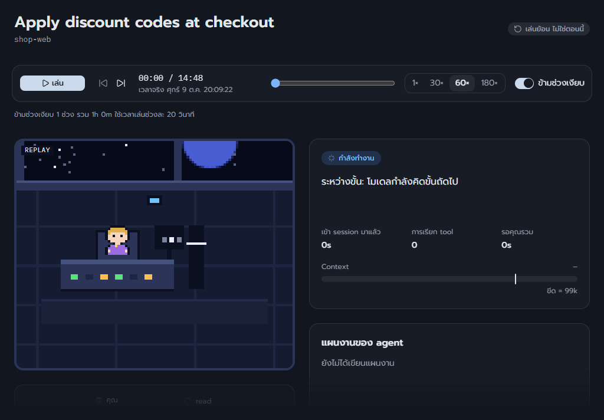
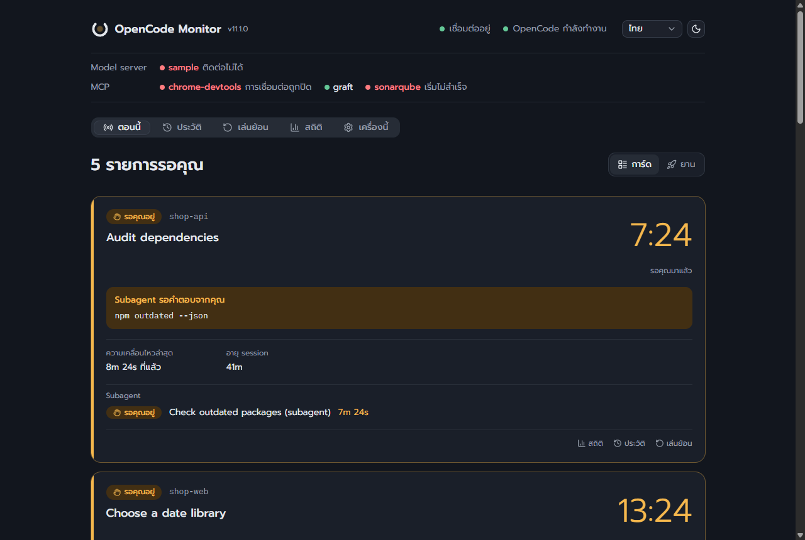
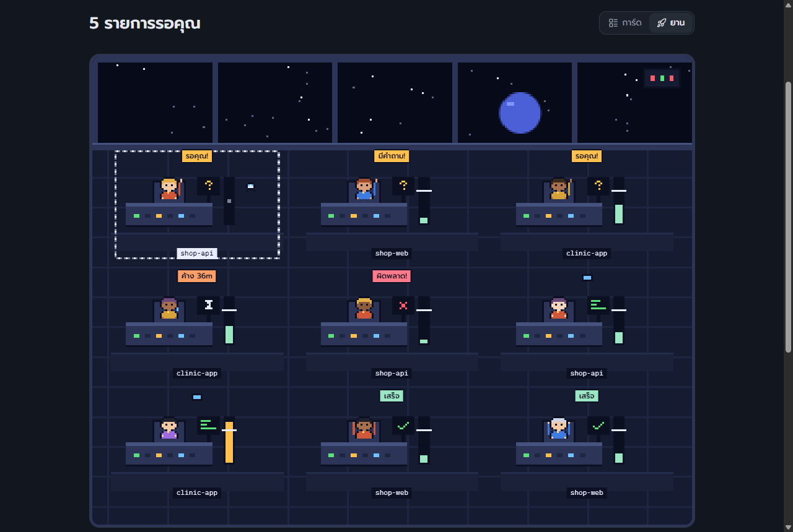
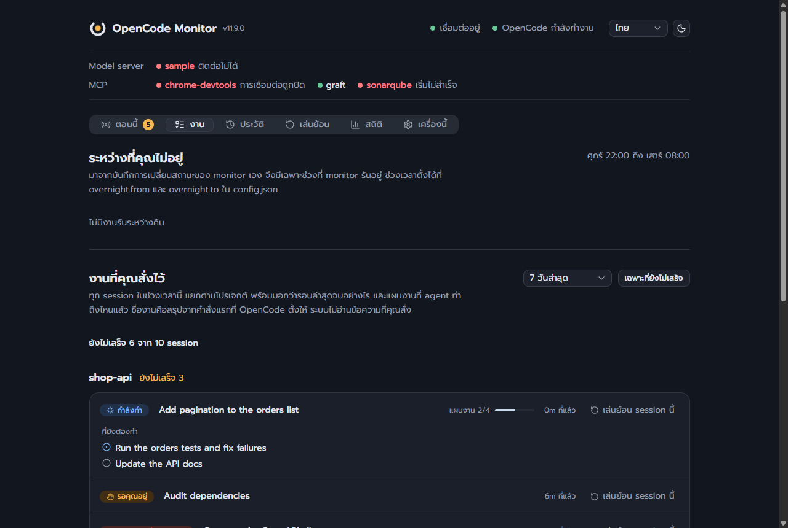
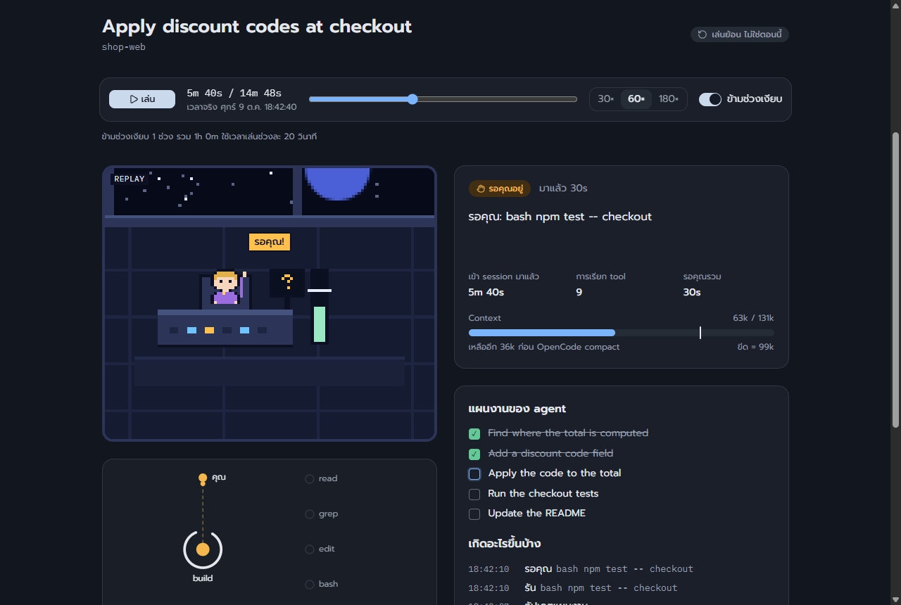
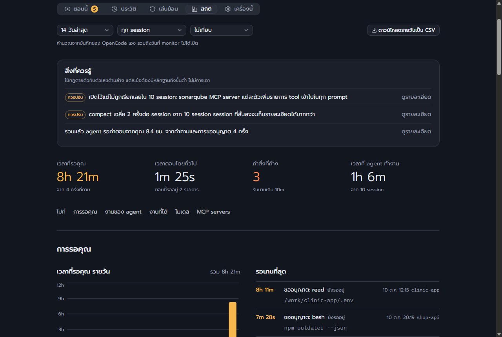
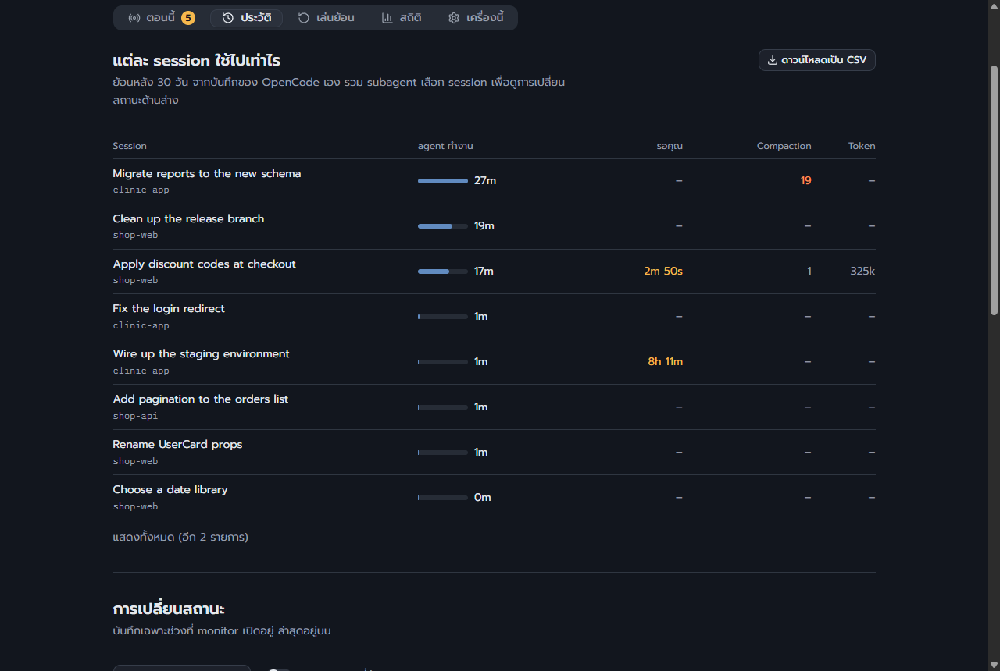
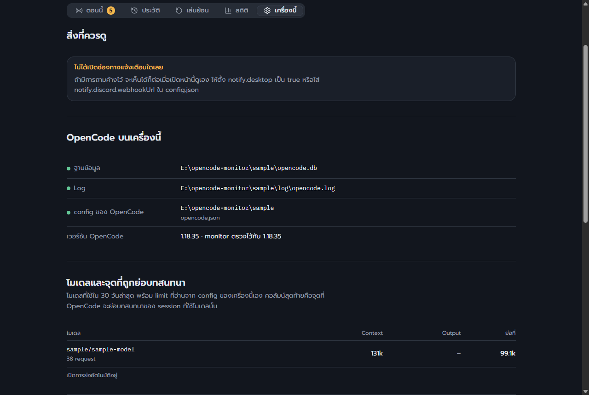

# opencode-monitor

[English](README.md) · **ไทย**

หน้าแสดงสถานะบนเครื่องของคุณเองสำหรับ [OpenCode](https://opencode.ai) ตอบคำถามเดียวให้เห็นในแวบเดียว: ตอนนี้ agent **กำลังทำงาน**, **รอคุณอยู่**, **น่าจะค้าง**, **เสร็จแล้ว** หรือ **เกิดข้อผิดพลาด**? รอบๆ คำถามนั้นยังเก็บสิ่งที่คุณต้องใช้เมื่อกลับมาทำงานต่อ: แต่ละ session ถูกสั่งให้ทำอะไรและไปถึงไหนแล้ว ข้ามคืนเกิดอะไรขึ้น model server กำลังทำอะไร และตัวเลขว่าเวลาและ token ไปอยู่ที่ไหน

เครื่องมือนี้เกิดขึ้นเพราะเรื่องอย่างเช่น มีคำขออนุญาตค้างรอคำตอบอยู่แปดชั่วโมงข้ามคืน ทั้งที่ดูเหมือน agent กำลังทำงานอยู่

- **อ่านอย่างเดียว** อ่านสิ่งที่ OpenCode บันทึกไว้บนดิสก์อยู่แล้ว และไม่เปลี่ยนอะไรใน OpenCode สำหรับ OpenCode 2 จะถาม OpenCode เพิ่มอีกหนึ่งอย่างที่ไม่ถูกบันทึกไว้ที่ใด คือ session กำลังรอให้คุณอนุญาตอะไร
- **อยู่ในเครื่อง** เปิดรับที่ `127.0.0.1` เท่านั้น เว้นแต่คุณเปิดให้เครือข่ายของคุณเองด้วย `--lan` ซึ่งอุปกรณ์อื่นทุกเครื่องต้องแสดงรหัสเข้าถึง ไม่มี telemetry ไม่มีอะไรออกจากเครื่องของคุณ เว้นแต่คุณตั้ง Discord webhook เอง
- **ไม่ต้องติดตั้ง** server ใช้เฉพาะโมดูลที่มากับ Node และหน้าเว็บ build มาให้แล้ว ต้องใช้ npm เฉพาะเมื่อจะแก้หน้าเว็บ (ดู [dashboard/](dashboard/README.md))
- **ซ่อน secret เป็นค่าเริ่มต้น** ก่อนจะแสดงหรือส่งอะไรออกไป

> **ไม่รับ contribution** Pull request จะถูกปิดโดยไม่ตรวจ และไม่รับคำขอฟีเจอร์ รายงาน bug ได้ทาง issue คุณ fork และแก้สำเนาของคุณเองได้อย่างอิสระ (MIT) รายละเอียด: [CONTRIBUTING.md](CONTRIBUTING.md)

## สารบัญ

- [ความสามารถ](#features)
- [หน้าตาเป็นอย่างไร](#what-it-looks-like)
- [เริ่มใช้งาน](#getting-started): สิ่งที่ต้องมี การรัน ตัวเลือก ให้รันอยู่ตลอด แอป และเครือข่ายภายในของคุณ
- การใช้งาน: [แท็บตอนนี้](#now-tab), [แถบสถานะ](#status-strip), [สิ่งที่ agent ทำ](#agent-did), [งาน](#tasks), [ประวัติ](#history), [เล่นย้อน](#replay), [สถิติ](#stats), [เครื่องนี้](#this-machine)
- [ถาม Claude เรื่องนี้](#mcp): MCP server รวมถึงจากเครื่องอื่น
- [การตั้งค่า](#settings) และ [Discord](#discord)
- [ข้อมูลมาจากไหน](#data) และไฟล์ที่ monitor เขียน
- [แก้ปัญหา](#troubleshooting)
- [ข้อจำกัด](#limits)
- [การพัฒนา](#development): โครงสร้างไฟล์ test คุณภาพโค้ด การปล่อยเวอร์ชัน
- [การมีส่วนร่วม](#contributing) · [ไม่มีส่วนเกี่ยวข้องกับ OpenCode](#not-affiliated) · [สัญญาอนุญาต](#license)

<a id="features"></a>

## ความสามารถ

- **สิ่งที่ต้องการคุณก่อน** สถานะของทุก session พร้อมบอกว่ารออะไรและตั้งแต่เมื่อไร แจ้งเตือนบน desktop และ Discord เมื่อ session รอ ค้าง ล้มเหลว วนซ้ำอยู่ที่เดิม หรือ OpenCode เลิกรอคำขอที่ไม่มีใครตอบ [แท็บตอนนี้](#now-tab)
- **โมเดลกำลังทำอะไร** ขณะที่ session รอ server ของ llama.cpp บอกว่าโมเดลอ่าน prompt ไปแล้วกี่ token และเร็วแค่ไหน หรือเขียนไปเท่าไร และเตือนเมื่อ server ไม่ได้ทำงานอะไรเลย [แท็บตอนนี้](#now-tab)
- **งานที่คุณสั่งไว้** ทุก session ในช่วงหลายวันล่าสุด แยกตามโปรเจกต์ จบอย่างไร และแผนงานเหลืออะไร พร้อมรายงานของคืนที่ผ่านมา: อะไรรันระหว่างที่คุณไม่อยู่ และไม่มีอะไรทำงานเลยนานเท่าไร [งาน](#tasks)
- **สิ่งที่ agent ต้องพึ่ง** model server (และโมเดลที่มันโหลดอยู่จริง) MCP server และ service ของคุณเอง [แถบสถานะ](#status-strip)
- **สิ่งที่มันทำ** ไฟล์ที่แตะ branch process ที่ยังรันค้าง และการเรียก tool ที่ควรดูอีกครั้ง [สิ่งที่ agent ทำ](#agent-did)
- **เวลาไปอยู่ไหน** การรอ การค้าง tool MCP server ความเร็วของโมเดล token และค่าใช้จ่าย compaction prompt ที่ถูกอ่านใหม่ และประโยคไม่กี่ข้อว่าอะไรควรเปลี่ยน [สถิติ](#stats)
- **ค่าใช้จ่าย** สำหรับโมเดลที่คุณจ่ายเงิน: รายวันและรายเดือน แยกตามโมเดลและ session ทั้งเดือนจะไปถึงเท่าไร และแจ้งเตือนเมื่อถึงงบที่คุณตั้ง [สถิติ](#stats)
- **ย้อนดู** ทุกการเปลี่ยนสถานะ และเล่นย้อน session ใดก็ได้ทีละช่วงเวลา หรือทั้งวันพร้อมกัน [ประวัติ](#history), [เล่นย้อน](#replay)
- **ถามเรื่องนี้** ตัวเลขชุดเดียวกันสำหรับ Claude Code ผ่าน MCP ทั้งบนเครื่องนี้หรือจากเครื่องอื่น [ถาม Claude เรื่องนี้](#mcp)

<a id="what-it-looks-like"></a>

## หน้าตาเป็นอย่างไร



**เล่นย้อน** · session หนึ่งที่เล่นย้อนจากบันทึกของ OpenCode เอง: agent ทำงาน รอคุณ ใช้ context จนต้อง compact แล้วทำจนเสร็จ

| | |
| --- | --- |
| <br>**ตอนนี้** · สิ่งที่ต้องการคุณมาก่อน พร้อมบอกว่ารอมานานแค่ไหน | <br>**ยาน** · session ชุดเดียวกันในรูปห้องบังคับการแบบ pixel art ที่ขยับตามจริง |
| <br>**งาน** · งานที่คุณสั่งไว้ และคืนที่ผ่านมาระหว่างที่คุณไม่อยู่ | <br>**เล่นย้อน** · เล่นย้อน session หนึ่งทีละช่วงเวลา |
| <br>**สถิติ** · ตัวเลขรวมกันแล้วหมายถึงอะไร แล้วจึงตามด้วยตัวเลข | <br>**ประวัติ** · แต่ละ session ใช้ไปเท่าไร และทุกการเปลี่ยนสถานะ |
| <br>**เครื่องนี้** · สิ่งที่พบบนเครื่องนี้ และสิ่งที่ขาด | |

ภาพเหล่านี้มาจาก `node server.mjs --sample` ซึ่งเป็นข้อมูลที่แต่งขึ้น รันคำสั่งนี้เพื่อลองทุกแท็บได้โดยไม่ต้องมี OpenCode ถ้า monitor นี้มีประโยชน์กับคุณ การกด star บน GitHub ช่วยให้คนอื่นเจอมันได้

<a id="getting-started"></a>

## เริ่มใช้งาน

### สิ่งที่ต้องมี

- Node.js 22.13 ขึ้นไป
- OpenCode 1.x หรือ 2 บนเครื่องเดียวกัน (โฟลเดอร์ข้อมูลของมัน ค่าเริ่มต้นคือ `~/.local/share/opencode`) ไม่จำเป็นสำหรับ `--sample`
- ไม่บังคับ: Discord webhook สำหรับการแจ้งเตือน, model server ของ llama.cpp เพื่อดูว่ามันรันอะไร, Claude Code เพื่อถามเรื่องตัวเลข

### ติดตั้งและรัน

```sh
git clone https://github.com/adcident12/opencode-monitor.git
cd opencode-monitor
node server.mjs
```

เปิด <http://127.0.0.1:4317>

ถ้าอยากดูโดยไม่ต้องมี OpenCode ให้รันกับข้อมูลปลอมที่สร้างขึ้น:

```sh
node server.mjs --sample
```

### ตัวเลือกบน command line

| ตัวเลือก | ความหมาย |
| --- | --- |
| `--port <n>` | พอร์ตที่เปิดรับ (ค่าเริ่มต้น 4317) |
| `--data-dir <path>` | โฟลเดอร์ข้อมูลของ OpenCode คือโฟลเดอร์ที่มี `opencode.db` |
| `--config <path>` | ไฟล์ตั้งค่า (ค่าเริ่มต้นคือ `config.json` ข้าง `server.mjs`) |
| `--lang <code>` | ภาษาของการแจ้งเตือน (`en`, `th`) |
| `--sample` | ใช้ข้อมูลปลอมที่สร้างขึ้น |
| `--no-notify` | ไม่แจ้งเตือนทั้ง desktop และ Discord |
| `--lan` | ตอบอุปกรณ์อื่นในเครือข่ายภายในของคุณด้วย โดยแต่ละเครื่องต้องมีรหัสเข้าถึง (ดู "เปิดให้เครือข่ายภายในของคุณ" ด้านล่าง) |
| `--access-key` | พิมพ์ที่อยู่สำหรับเปิดบนอุปกรณ์อื่นพร้อมรหัส และคำสั่งสำหรับ Claude Code บนเครื่องอื่น แล้วจบ |
| `--assume-running` | ข้ามการตรวจว่ามี process ของ OpenCode รันอยู่ |
| `--version` | พิมพ์เวอร์ชันแล้วจบ |
| `--doctor` | พิมพ์สิ่งที่ monitor พบบนเครื่องนี้ และสิ่งที่ขาด แล้วจบ |
| `--test-notify` | ส่งตัวอย่างการแจ้งเตือนทุกชนิดที่เปิดไว้ (`notify.on`) ไปทุกช่องทาง แล้วพิมพ์ว่าแต่ละช่องทางรับได้อย่างไร |
| `--autostart on` / `off` | เริ่ม monitor ทุกครั้งที่คุณ login หรือเลิกทำเช่นนั้น แล้วจบ |

### ให้รันอยู่ตลอด

monitor มีประโยชน์เฉพาะตอนที่มันรันอยู่ และคืนที่ prompt ค้างรอคำตอบ ก็มักเป็นคืนที่ terminal ที่ลืมไว้ถูกปิดไปแล้ว บน Windows:

```sh
node server.mjs --autostart on
```

จะลงทะเบียน scheduled task ชื่อ `opencode-monitor` ให้ผู้ใช้ของคุณ (ไม่ต้องใช้สิทธิ์ administrator) ซึ่งเริ่ม monitor ทุกครั้งที่ login โดยไม่มีหน้าต่าง console ตัวเลือกที่ให้มาพร้อมกัน (`--port`, `--data-dir`, `--config`, `--lang`, `--no-notify`) จะถูกเก็บไว้ `schtasks /Run /TN opencode-monitor` เริ่มมันทันที และ `node server.mjs --autostart off` ลบ task ออก task ชี้มาที่โฟลเดอร์นี้และ Node ตัวที่คุณใช้รัน ดังนั้นให้รันคำสั่งอีกครั้งหลังย้ายอย่างใดอย่างหนึ่ง

บน macOS คำสั่งเดียวกันเขียน launchd agent ไปที่ `~/Library/LaunchAgents/com.opencode-monitor.plist` (ผลลัพธ์ไปที่ `~/Library/Logs/opencode-monitor.log`) และบน Linux เขียน systemd user unit ไปที่ `~/.config/systemd/user/opencode-monitor.service` ทั้งสองเริ่ม monitor ทันทีและทุกครั้งที่ login และ `--autostart off` ลบออก บนทั้งสามระบบ CI ทำสิ่งนี้จริงทุกครั้งที่ push: เปิด autostart รอให้ monitor ที่ระบบเริ่มให้ตอบ ปิด แล้วตรวจว่าหายไปแล้ว สิ่งที่ CI แสดงให้เห็นไม่ได้คือการ login เข้า desktop หลัง reboot ถ้า monitor ไม่อยู่หลังคุณ login ให้ดู `--doctor` และ log ของระบบเอง (`journalctl --user -u opencode-monitor` หรือ `~/Library/Logs/opencode-monitor.log`) ว่าเพราะอะไร

### ติดตั้งเป็นแอป

ใน Chrome หรือ Edge ปุ่ม **ติดตั้งแอป** ที่ด้านบนของหน้า จะเปิด monitor ในหน้าต่างของตัวเอง มีไอคอนของตัวเองบนทาสก์บาร์และในเมนู Start แทนการเปิดเป็นแท็บของ browser ปุ่มนี้แสดงเฉพาะเมื่อ browser เสนอให้ติดตั้งได้ จึงหายไปเมื่อติดตั้งแล้ว ส่วน browser อื่นไม่มีข้อเสนอนี้ (Safari มี **Add to Dock** ในเมนู File)

แอปยังคงเป็นหน้านี้ที่ monitor บนเครื่องนี้ส่งให้ ไม่มีอะไรถูกคัดลอกไปที่อื่น และแสดงข้อมูลได้เฉพาะขณะที่ monitor รันอยู่ จึงเหมาะจะใช้คู่กับ `--autostart on` แอปถูกติดตั้งตามที่อยู่ที่เปิดไว้ จึงควรใช้พอร์ตเดิม หากต้องการเอาออก ให้ใช้เมนูของหน้าต่างแอป (**Uninstall**)

### เปิดให้เครือข่ายภายในของคุณ

โดยค่าเริ่มต้น monitor ตอบเฉพาะเครื่องนี้เท่านั้น หากต้องการดูจากมือถือหรือคอมพิวเตอร์อีกเครื่องในเครือข่ายเดียวกัน ให้เริ่มด้วย `--lan` (หรือตั้ง `"lan": true` ใน `config.json`):

```sh
node server.mjs --lan
node server.mjs --access-key
```

คำสั่งที่สองพิมพ์ที่อยู่สำหรับเปิดบนอุปกรณ์อีกเครื่อง โดยมีรหัสเข้าถึงอยู่ในนั้น เปิดเพียงครั้งเดียว อุปกรณ์นั้นจะถูกจำไว้หนึ่งปีด้วย cookie และรหัสจะถูกเอาออกจากที่อยู่ที่ค้างไว้ อุปกรณ์ที่มาโดยไม่มีรหัสจะเห็นหน้าที่ขอรหัส และไม่ได้อะไรอื่นเลย ทั้งหน้าเว็บ ตัวเลข และการอัปเดตสด

- หน้านี้แสดงคำสั่ง path และสิ่งที่คุณสั่ง agent โดยซ่อนความลับเหมือนที่อื่น ใครมีรหัสก็เห็นทั้งหมด จึงควรให้เฉพาะอุปกรณ์ของคุณเอง และเฉพาะบนเครือข่ายที่คุณไว้ใจ หน้านี้ยังคงอ่านอย่างเดียว ไม่มีอะไรถูกแก้หรือสั่งรันผ่านมันได้
- รหัสคืออักขระสุ่ม 32 ตัว เก็บไว้ใน `data/access-key` ซึ่งอ่านได้เฉพาะคุณ รหัสจะถูกพิมพ์เมื่อคุณขอด้วย `--access-key` เท่านั้น ไม่พิมพ์ตอนเริ่มทำงาน จึงไม่ไปอยู่ใน log หากต้องการรหัสใหม่ ให้ลบไฟล์นั้นแล้วเริ่ม monitor อีกครั้ง อุปกรณ์ทุกเครื่องจะต้องขอใหม่
- เครื่องนี้ไม่ต้องใช้รหัสเลย และคำขอที่มาถึงด้วยชื่ออื่นนอกจากที่อยู่ของเครื่องนี้เองจะถูกปฏิเสธ address แบบ link-local (169.254.x.x) ไม่นับเป็นที่อยู่ของเครื่องนี้
- การเชื่อมต่อเป็น `http` ธรรมดา เหมือนที่ `127.0.0.1` บนเครือข่ายที่ผู้อื่นดักฟังได้ เขาอาจอ่านได้ monitor ไม่เปิด router ของคุณและไม่ออกอินเทอร์เน็ต ส่วน firewall ของคุณอาจถามว่าจะให้ Node รับการเชื่อมต่อหรือไม่ในครั้งแรก
- **ติดตั้งแอป** ใช้ได้บนเครื่องนี้เท่านั้น เพราะ browser ติดตั้งจาก `http` ได้ที่ `127.0.0.1` ไม่ใช่ที่อยู่ในเครือข่าย

<a id="now-tab"></a>

## แท็บตอนนี้

### สถานะแต่ละแบบหมายถึงอะไร

| สถานะ | ตัดสินอย่างไร |
| --- | --- |
| รอคุณอยู่ | มีการเรียก tool `question` ค้างอยู่ หรือมีคำขออนุญาตถูกบันทึกไว้สำหรับการเรียก tool ที่ไม่ขยับอีกเลยตั้งแต่นั้น prompt ของ subagent แสดงที่ session แม่ด้วย |
| น่าจะค้าง | การเรียก tool ครั้งหนึ่งรันนานกว่า `stuckToolMinutes` หรือไม่มีอะไรเกิดขึ้นเลยนาน `silentMinutes` ขณะที่โมเดลยังค้างคำตอบอยู่ |
| เกิดข้อผิดพลาด | request ล่าสุดไปยังโมเดลล้มเหลว หรือคำตอบชน limit ของ output token |
| กำลังทำงาน | มี tool กำลังรัน หรือโมเดลกำลังสร้างขั้นถัดไป |
| เสร็จแล้ว | agent จบรอบของมันตามปกติ |
| ไม่ได้ทำงาน | ยังไม่มีข้อความ ถูกผู้ใช้หยุด OpenCode ถูกปิดกลางงาน หรือ OpenCode เลิกรอคำตอบที่ไม่มีใครให้ |

การเรียก tool ที่ล้มเหลวเพียงอย่างเดียวไม่ถือเป็นสถานะผิดพลาด เพราะปกติ agent กู้กลับมาได้เอง การเรียกที่ล้มเหลวจะถูกนับไว้ในสุขภาพของ session แทน

สำหรับ session ที่ยังทำงานอยู่ หน้าเว็บยังแสดงว่าไปถึงไหนแล้ว:

- คำสั่งที่กำลังรัน บรรทัดสุดท้ายที่มันพิมพ์ และบรรทัดสุดท้ายมาถึงเมื่อนานแค่ไหนแล้ว "รันมา 35 นาที ผลลัพธ์ล่าสุดเมื่อ 34 นาทีที่แล้ว" คือหน้าตาของคำสั่งที่ค้าง
- มีอะไรเกิดขึ้นใน session ครั้งล่าสุดเมื่อใด
- การเรียก tool ล่าสุดของรอบปัจจุบัน พร้อมผลและระยะเวลา
- แผนงานของ agent เอง เสร็จกี่ข้อจากทั้งหมด พร้อมข้อที่กำลังทำ session ที่จบแล้วแต่แผนยังทำไม่ครบจะยังแสดงว่าทำไปถึงไหน
- **model server กำลังทำอะไรให้มัน** จาก slot ของ server ของ llama.cpp (ถามทุกสามวินาทีขณะที่ session รอโมเดล): กำลังอ่าน prompt พร้อมจำนวน token ที่อ่านไปแล้วและความเร็ว กำลังเขียน พร้อมจำนวน token และความเร็ว หรือไม่ได้ทำงานกับ request ใดเลยครบหนึ่งนาที ซึ่งเป็นปัญหาที่ server ไม่ใช่ที่ agent llama.cpp ไม่บอกความยาวของ prompt จนกว่าจะอ่านจบ จึงไม่แสดงเป็นสัดส่วนและไม่บอกเวลาที่เหลือ และแสดงเฉพาะเมื่อมี session เดียวรอ server นั้น เพราะไม่รู้ว่า slot ทำงานให้ session ไหน

OpenCode บันทึกคำตอบของโมเดลเฉพาะตอนเริ่มและตอนจบ ดังนั้นข้อความที่กำลังเขียนจะไม่ถูกแสดงเลย แต่กับ server ของ llama.cpp slot ของมันจะบอกว่าเขียนไปแล้วเท่าไร

แต่ละ session ยังแสดงสุขภาพของมัน: context ที่ใช้เทียบกับ limit ของโมเดล จำนวน compaction อายุ session การเรียก tool ที่ล้มเหลว และมีคำสั่งเดิมวนซ้ำหรือไม่ เมื่อ agent วนซ้ำอยู่ที่เดิม หน้าเว็บจะบอก และถ้ามี `"loop"` ใน `notify.on` (เปิดไว้เป็นค่าเริ่มต้น) จะแจ้งหนึ่งครั้งทุกครั้งที่เริ่มเป็น: เรียกแบบเดิมติดกัน (call เดียว 8 ครั้ง หรือสองสามอย่างสลับกัน 6 รอบ) tool ตัวเดียวล้มเหลว 4 ครั้งโดยไม่สำเร็จเลยในระหว่างนั้นขณะที่ agent ยังพยายามต่อ หรือทำงานหนึ่งชั่วโมงและ 30 calls โดยที่แผน (todo list) ไม่เปลี่ยนทั้งที่ยังมีรายการค้าง แถบ context มีขีดบอกจุดที่ OpenCode จะ compact session นั้น ไม่มีส่วนใดของจุดนี้ที่ตายตัวอยู่ใน monitor: มันถูกคำนวณให้แต่ละ session ด้วยกฎของ OpenCode ตัวที่กำลังรัน session นั้น (อ่านจาก log ของมัน) จาก limit ที่คุณตั้งให้โมเดลนั้นใน `opencode.json` (ไฟล์ของโปรเจกต์มาก่อนไฟล์กลาง)

OpenCode 1.x:

- reply = ค่าที่น้อยกว่าระหว่าง `limit.output` กับ 32,000 (หรือ `OPENCODE_EXPERIMENTAL_OUTPUT_TOKEN_MAX`)
- โมเดลที่มี `limit.input`: `limit.input` − (`compaction.reserved` หรือค่าที่น้อยกว่าระหว่าง 20,000 กับ reply)
- โมเดลอื่น: `limit.context` − reply
- `compaction.auto: false`: ไม่ compact เลย และการ์ดจะบอกไว้

OpenCode 2: ขนาดหน้าต่าง (`limit.input` ถ้าไม่มีใช้ `limit.context`) ลบ `compaction.buffer` หรือลบหนึ่งในสิบของหน้าต่าง อย่างน้อย 16,000 limit ของ output ไม่เกี่ยว

ดังนั้นกับ OpenCode 1.x context 32,768 กับ output 4,096 จะ compact ที่ 28,672 และ context 131,072 กับ output 32,768 จะ compact ที่ 99,072 ใต้แถบ หน้าเว็บบอกว่าเหลืออีกกี่ token ก่อนถึงจุดนั้น และจากการโตของ request ไม่กี่ครั้งล่าสุด บอกคร่าวๆ ว่าเหลืออีกกี่ request ระบบเตือนเมื่อ session ไปถึง 85% ของจุดนั้น หรือเหลืออีก 3 request (`thresholds.compactWarnPct`, `thresholds.compactWarnRequests`) เมื่อค่าเหล่านี้ดูไม่ดี หน้าเว็บจะแนะนำให้เริ่ม session ใหม่

### ยานอวกาศ

session ชุดเดียวกันดูเป็นห้องบังคับการของยานอวกาศได้: สลับระหว่าง **การ์ด** กับ **ยาน** ที่ข้างหัวข้อของแท็บตอนนี้ และเบราว์เซอร์นั้นจะจำตัวเลือกไว้ แต่ละ session คือลูกเรือหนึ่งคนที่แผงควบคุม ตัวที่ต้องการคุณอยู่แถวหน้า และขยับตามที่การ์ดจะเปลี่ยน ทุกสองวินาที

- ยกมือพร้อมกล่องคำพูดสีเหลือง: รอคุณอยู่ เหงื่อตกและมีนาฬิกาทรายบนจอ: น่าจะค้าง กากบาทแดง: เกิดข้อผิดพลาด ยกแขน: เสร็จแล้ว ฟุบหลับบนแผง: ไม่ได้ทำงาน
- ขณะทำงาน จอแสดง tool ที่ใช้: ตัวหนังสือเขียวคือ shell เส้นสีคือ edit หน้ากระดาษคือ read ลูกโลกคือเว็บหรือ MCP server
- มาตรวัดข้างแผงแต่ละตัวคือ context มีขีดสีขาวที่จุดที่ OpenCode compact เปลี่ยนเป็นสีเหลืองเมื่อใกล้ถึง และมีไอพ่นเมื่อเพิ่ง compact โดรนข้างสถานีคือ subagent ที่กำลังทำงาน และไฟบนผนังคือ MCP server

เลือกสถานีเพื่อดูการ์ดของ session นั้นใต้ภาพ บนยานเขียนไว้เพียงชื่อโฟลเดอร์ของโปรเจกต์ และตัดด้วย "…" เมื่อยาวเกิน ชื่อเต็มและรายละเอียดอื่นทั้งหมดอยู่ในการ์ด ชื่อที่ยาวจึงไม่ล้นไปทับสถานีข้างๆ กล่องคำพูดบอกสถานะด้วยคำหนึ่งหรือสองคำ และไม่ยกข้อความจาก session มาเลย มีได้มากสุดสิบสองสถานี เกินจากนั้นหน้าเว็บจะบอกว่าเหลืออีกกี่ session และแบบการ์ดแสดงครบทุกตัว บนมือถือห้องบังคับการมีสองคอลัมน์ ภาพจะหยุดนิ่งสำหรับผู้ที่ตั้งค่าระบบให้ลดการเคลื่อนไหว ลูกเรือและยานวาดด้วยโค้ดสำหรับโปรเจกต์นี้โดยเฉพาะ ไม่ได้ใช้ภาพของผู้อื่น

<a id="status-strip"></a>

## แถบสถานะ

แถบด้านบนแสดงสิ่งที่ agent ต้องพึ่ง:

- **Model server**: provider ใน config ของ OpenCode ที่มี `baseURL` ของตัวเอง จะถูกเรียกที่ `<baseURL>/health` (ไม่ส่ง credential และคำตอบใดก็ตามที่ต่ำกว่า HTTP 500 นับว่าใช้ได้ server ที่ไม่มี address นี้จึงยังนับว่าใช้ได้ ส่วน server ที่ยังโหลดโมเดลไม่เสร็จไม่นับ) โดยค่าเริ่มต้นจะตรวจเฉพาะ address บนเครื่องนี้หรือในเครือข่ายนี้ ตั้ง `environment.modelServers` เป็น `"all"` เพื่อรวมที่อื่นด้วย หรือ `"off"`
  - **สิ่งที่รันอยู่จริง** server ของ llama.cpp จะถูกขอการตั้งค่าด้วย (`/props` ทุกห้านาทีและเมื่อกลับมาทำงาน): โมเดลที่โหลดอยู่และ context ที่ตั้งไว้ตอนเริ่ม ชี้เมาส์เพื่อดู จะขึ้นสีแดงเมื่อ session ที่กำลังทำงานขอโมเดลอื่นที่ไม่ใช่ตัวที่โหลดอยู่ (server ตอบอยู่ดีในชื่อที่ถูกขอ ตัวเลขของ OpenCode จึงบันทึกโมเดลผิด) หรือเมื่อ OpenCode คิดว่า context ใหญ่กว่าของ server (request ที่เกินจะถูกปฏิเสธก่อนที่ OpenCode จะ compact) การเทียบโมเดลทำเฉพาะเมื่อ server เริ่มด้วย `--alias` server ที่ต้องใช้รหัสจะให้การตั้งค่าเมื่อมีรหัสเท่านั้น: ระบุที่อยู่ของรหัสใน `modelServerKeys` เป็น `"{env:NAME}"` หรือ `"{file:path}"` ตาม provider id ของ OpenCode (`{"local-llama": "{env:LLAMA_API_KEY}"}`) การใส่ตัวรหัสลงใน `config.json` ตรงๆ จะถูกปฏิเสธ เพื่อให้แชร์ไฟล์ได้ รหัสจะถูกส่งไปที่ server นั้นเท่านั้น เหมือนที่ OpenCode ส่ง server ที่ปฏิเสธ (ไม่มีรหัส รหัสผิด หรือไม่มี `/props`) จะถูกถามครั้งเดียวต่อการเปิด monitor หนึ่งครั้ง แล้วไม่ถามอีก เพื่อไม่ให้ log ของ server เต็มไปด้วยการเข้าสู่ระบบที่ล้มเหลว
- **MCP server**: OpenCode บันทึกเฉพาะความล้มเหลวของ MCP สถานะจึงเป็นการอนุมาน *ล้มเหลว* หมายถึง OpenCode ที่รันอยู่บันทึกว่า server ล้มเหลว หรือการเรียก tool พบว่าการเชื่อมต่อหายไป และหลังจากนั้นยังไม่มี tool ใดของมันทำงานได้ *OK* หมายถึงมี tool ของมันทำงานสำเร็จ *ไม่มีสัญญาณ* หมายถึงไม่ใช่ทั้งสองอย่าง OpenCode 2 ยังบันทึกการเชื่อมต่อแต่ละครั้งพร้อมจำนวน tool ที่ได้ด้วย server ที่ OpenCode 2 ซึ่งรันอยู่เชื่อมต่อแล้ว จะขึ้นว่า *เชื่อมต่อแล้ว* ตั้งแต่ก่อนมีการเรียกใช้ tool และการเชื่อมต่อหลังจากล้มเหลวหมายถึงกลับมาใช้ได้แล้ว server ที่เชื่อมต่อได้แต่ไม่มี tool จะขึ้นเป็นสีเทาว่า *เชื่อมต่อแล้ว ไม่มี tool* ไม่นับเป็นความล้มเหลว เพราะบาง server ให้ tool เฉพาะในโปรเจกต์ที่ตั้งค่าไว้ (เช่น graft จนกว่าจะ index โปรเจกต์นั้น) server ที่ `opencode.json` ของโปรเจกต์เพิ่มหรือเปิดไว้ จะถูกรวมสำหรับ session ที่อยู่บนจอ การเชื่อมต่อที่ปิดเพราะ OpenCode เองปิดตัว ไม่นับเป็นความล้มเหลว
- **Service**: อะไรก็ตามที่คุณระบุไว้ใต้ `services` ใน `config.json` ด้วย URL หรือด้วย host กับ port

เมื่อเปิด `notify.environment` คุณจะได้รับแจ้งหนึ่งครั้งเมื่อสิ่งใดในนี้ล่ม

<a id="agent-did"></a>

## สิ่งที่ agent ทำ

การ์ดของแต่ละ session มีส่วนที่กางออกได้

**งานที่ทำ** แสดงไฟล์ที่ agent แตะ และ git branch ที่โปรเจกต์อยู่ ระบบเตือนทุกครั้งที่ session อยู่บน branch ที่ป้องกันไว้ (ค่าเริ่มต้นคือ `main` หรือ `master`) ไม่ว่าจะตรวจพบการเปลี่ยนไฟล์หรือไม่: จำนวนไฟล์นับเฉพาะ tool แก้ไขไฟล์ ไม่รวมการเปลี่ยนที่ทำผ่านคำสั่ง shell

**ยังรันอยู่** แสดง process ที่ session นี้สั่งรันเบื้องหลังไว้ (dev server ผ่าน `Start-Process`, `nohup`, `docker compose up -d`) และยังไม่จบ พร้อม PID, port ที่เปิดรับ และคำสั่งสำหรับหยุดด้วยตัวคุณเอง process ถูกจับคู่กับคำสั่งที่เริ่มมันด้วยเวลาเริ่ม (ภายในหนึ่งนาทีหลังคำสั่ง) และคำที่ตรงกัน ดังนั้นให้ตรวจคำสั่งก่อนหยุดอะไร monitor ไม่เคยหยุด process เอง ปิดส่วนนี้ได้ด้วย `work.processes: false`

**ควรตรวจ** เป็นรายการชี้แนะ ไม่ใช่การควบคุมความปลอดภัย แสดงการเรียก tool ที่ควรดูอีกครั้ง พร้อมบอกว่าคุณถูกถามหรือไม่ (*ถามคุณแล้ว และคำสั่งได้รัน*, *กฎอนุญาตเอง ไม่ได้ถาม* หรือ *คุณปฏิเสธ*):

| ชนิด | ตัวอย่าง |
| --- | --- |
| เสี่ยง | คำสั่งที่ถูกประกอบขึ้นตอนรันจนอ่านไม่ได้ (`eval`, script ที่เข้ารหัสหรือ pipe เข้ามา), ลบแบบ recursive, kill process, force push, `git reset --hard`, `DROP TABLE`, `docker system prune`, pipe ไฟล์ที่ดาวน์โหลดเข้า shell |
| ค่า secret | ค่าที่ดูเหมือน secret ในคำสั่งหรือในผลของ tool (แสดงแบบปิดบัง ต้นฉบับยังอยู่ในฐานข้อมูลของ OpenCode เอง) |
| ไฟล์ secret | การอ่าน `.env`, private key, ไฟล์ credential |
| ส่งออกนอกเครื่อง | `git push`, การ publish, request ไปยัง host นอกเครือข่ายของคุณ, `ssh`/`scp` |
| รันเบื้องหลัง | คำสั่งที่ทิ้ง process ไว้ให้รันต่อ (`Start-Process`, `nohup`, `docker compose up -d`) |

ทั้งหมดนี้คือการจับคู่รูปแบบ เพื่อชี้ให้คุณไปดู ไม่ได้พิสูจน์ว่ามีอะไรเกิดขึ้น และคำสั่งที่เขียนแปลกไปจะไม่ถูกจับ OpenCode บันทึกว่ามันถาม แต่ไม่บันทึกว่าคุณตอบอะไร ดังนั้น "ถามคุณแล้ว" จึงอนุมานจาก prompt ที่ถูกบันทึกในจังหวะที่การเรียกเริ่ม

ถ้ากฎใดเป็นแค่สิ่งรบกวนสำหรับคุณ ให้ใส่ไว้ใต้ `review.ignoreRules` ใน `config.json` (ชื่อกฎคือ key `rule.*` ใน `i18n/en.json` เช่น `"kill_process"` หรือ `"background"`) การเรียกที่ถูกจับด้วยกฎเดียวกันจะแสดงเป็นรายการเดียว พร้อมจำนวนและทุกคำสั่งที่ต่างกันในนั้น คำสั่งที่ไม่มีพิษภัยจึงบังคำสั่งอันตรายภายใต้กฎเดียวกันไม่ได้ สิ่งใดที่ถูกตัดเพราะยาว หรือถูกเว้นด้วย `review.ignoreRules` จะถูกนับไว้บนหน้าเว็บ ไม่ถูกทิ้งไปเงียบๆ

<a id="tasks"></a>

## งาน

เมื่อมีหลาย session ทำงานพร้อมกัน ง่ายที่จะจำไม่ได้ว่าสั่งอะไรไปบ้าง และแต่ละงานไปถึงไหนแล้ว แท็บ **งาน** แสดงทุก session ของ 7, 14 หรือ 30 วันล่าสุด แยกตามโปรเจกต์: ชื่องาน (สรุปจากคำสั่งแรกที่ OpenCode ตั้งให้ ระบบไม่อ่านข้อความที่คุณสั่ง) รอบล่าสุดจบอย่างไร (กำลังทำ รอคุณอยู่ น่าจะค้าง ถูกขัดจังหวะ หยุดเพราะข้อผิดพลาด หรือส่งกลับให้คุณแล้ว) และแผนงานที่ agent ทำอยู่ เป็นจำนวนที่เสร็จจากทั้งหมด พร้อมรายการที่ยังต้องทำ session ที่ยังไม่เสร็จขึ้นก่อนในแต่ละโปรเจกต์ และ "เฉพาะที่ยังไม่เสร็จ" ซ่อนที่เหลือ session ที่ agent ไม่ได้เขียนแผนไว้ เช่นงานเล็ก จะบอกแค่ว่าจบอย่างไร

แผนงานคือ todo list ของ agent เอง OpenCode 1.x เก็บไว้ในฐานข้อมูล ส่วน OpenCode 2 เก็บไว้แค่ในการเรียก `todowrite` ครั้งล่าสุดของ agent ระบบอ่านทั้งสองแบบ

ด้านบนของแท็บ **ระหว่างที่คุณไม่อยู่** รายงานคืนล่าสุด (`overnight.from` ถึง `overnight.to` ค่าเริ่มต้น 22:00 ถึง 08:00): ทุก session ที่รัน ทำงานและรอคุณนานเท่าไร และจบอย่างไรพร้อมสาเหตุ (รอคำอนุญาต, error จาก model server, OpenCode เลิกรอ) และด้านบนสุดคือช่วงที่ยาวที่สุดที่ไม่มีอะไรทำงานเลยขณะที่มี session รอคุณ ข้อมูลมาจากบันทึกการเปลี่ยนสถานะของ monitor เอง จึงครอบคลุมเฉพาะช่วงที่ monitor รันอยู่ และว่างเปล่าเมื่อปิด `history.enabled` เมื่อเปิด `notify.overnight.enabled` จะส่งไป Discord ด้วยเมื่อจบช่วงกลางคืน (ดู [Discord](#discord))

<a id="history"></a>

## ประวัติ

แท็บ **ประวัติ** แสดงทุกการเปลี่ยนสถานะ ใหม่สุดก่อน: session เริ่มรอเมื่อใด ทำงานมานานเท่าไรก่อนหน้านั้น กำลังรันอะไรอยู่ตอนที่ค้าง เหนือรายการ **แต่ละ session ใช้ไปเท่าไร** จัดอันดับ session ของ 30 วันล่าสุดตามเวลาทำงานของ agent พร้อมเวลาที่รอคุณ จำนวน compaction และ token โดยรวม subagent ด้วย และนำมาจากบันทึกของ OpenCode เอง คลิก session เพื่อตามมันในรายการด้านล่าง "ดาวน์โหลดเป็น CSV" บันทึกตารางนั้น ส่วนในสถิติ "ดาวน์โหลดรายวันเป็น CSV" บันทึกตัวเลขรายวัน ไฟล์ถูกสร้างในหน้าเว็บจากสิ่งที่แสดงอยู่แล้ว โดย escape ชื่อที่ดูเหมือนสูตรของ spreadsheet

ติ๊ก "เฉพาะรายการที่ต้องรอคุณ" เพื่อดูแค่การรอ การค้าง และข้อผิดพลาด หรือเลือก session เดียวเพื่อตามตั้งแต่ต้นจนจบ ระบบแสดง 100 รายการล่าสุด "โหลดรายการก่อนหน้า" นำ 100 รายการถัดไปมา และรายการใหม่ยังคงปรากฏที่ด้านบนโดยไม่ขยับสิ่งที่โหลดไว้แล้ว ตัวกรองทั้งสองใช้กับบันทึกทั้งหมด ไม่ใช่เฉพาะสิ่งที่อยู่บนจอ

ประวัติถูกบันทึกเฉพาะขณะที่ monitor รันอยู่ ลงใน `data/history.jsonl` (git ไม่ติดตาม หนึ่ง JSON object ต่อบรรทัด และปิดบัง secret แล้ว) รายการที่เก่ากว่า `history.retentionDays` จะถูกลบตอนเริ่ม ตั้ง `history.enabled` เป็น `false` เพื่อปิด ลบไฟล์เพื่อล้างประวัติ

<a id="replay"></a>

## เล่นย้อน

แท็บ **เล่นย้อน** เล่นย้อน session หนึ่ง: เลือกจากรายการ หรือกด **เล่นย้อน** ท้ายการ์ดใดก็ได้ หรือ **เล่นย้อน session นี้** ในแท็บสถิติ ประวัติ และงาน (`#replay/<session id>` จึง bookmark ได้) ทั้งแท็บติดป้ายไว้ว่าเป็นการเล่นย้อน ลูกเรือที่ยกมืออยู่ในนั้นจึงไม่ถูกเข้าใจว่ามีคนรอคุณอยู่ตอนนี้

- ตัวเล่นมีปุ่มเล่นและหยุด ปุ่มข้ามไปเหตุการณ์ถัดไปหรือย้อนกลับ แถบเลื่อน ความเร็วเจ็ดระดับตั้งแต่ความเร็วจริง (1×) ถึง 180× และเวลาจริงของช่วงที่กำลังเล่น เวลาของแต่ละรายการใน **เกิดอะไรขึ้นบ้าง** กดเพื่อกลับไปยังช่วงนั้นได้ เช่นเดียวกับการคลิกบน timeline
- ในภาพ agent กับ tool ของมัน จุดจะวิ่งตามเส้นไปยัง tool ที่กำลังใช้ หรือไปหาคุณขณะรอคุณ และมีวงแหวนแผ่ออกจาก agent ขณะอ่าน คิด หรือเขียน เมื่อทำเสร็จแล้วจะไม่มีอะไรเคลื่อนไหว tool ที่ใช้บ่อยที่สุดมีที่ของตัวเอง ที่เหลือใช้ที่เดียวกันโดยบอกชื่อตัวที่กำลังใช้ เมื่อเล่นเร็ว การเรียกที่ยาวหนึ่งวินาทีจะอยู่บนจอเพียงชั่วพริบตา เส้นของมันจึงค้างไว้ครู่หนึ่งแล้วจางลง
- **ข้ามช่วงเงียบ** เปิดเป็นค่าเริ่มต้น: ช่วงที่นานกว่าสองนาทีโดยไม่มีอะไรเกิดขึ้นเลย (คุณกลับบ้าน หรือ agent ทำเสร็จแล้วรออยู่) ใช้เวลาเล่น 20 วินาที และมีเครื่องหมายบน timeline ปิดเพื่อเล่นตามเวลาจริง
- ในแต่ละช่วงเวลา: สถานีของ session บนยาน, แผงที่แท็บตอนนี้จะแสดง (สถานะ กำลังทำอะไรและนานเท่าไร จำนวนการเรียกจนถึงตอนนั้น เวลาที่รอคุณ และ context เทียบกับจุดที่ OpenCode compact), ภาพ agent กับ tool ที่มันใช้และ subagent ขณะทำงาน, แผนงาน ณ ตอนนั้น และสิ่งที่เกิดขึ้นจนถึงตอนนั้น
- ด้านล่างเป็น timeline ของ session และ subagent แต่ละตัว: อ่าน prompt คิด เขียน tool การ compact และการรอคุณ พร้อมเครื่องหมายทุก compaction ชี้เพื่อดูว่าตอนนั้นเกิดอะไรขึ้น คลิกเพื่อไปที่เวลานั้น

ข้อมูลอ่านจากบันทึกของ OpenCode เอง ด้วยกฎของแท็บตอนนี้ จึงใช้ได้กับ session ที่ monitor ไม่เคยเห็น และ session ที่ยังทำงานอยู่จะยาวขึ้นตรงท้าย ข้อความที่โมเดลเขียนไม่ถูกเล่นย้อน เพราะ OpenCode บันทึกแค่เวลาที่คำตอบเริ่มและจบ และไม่มีการแต่งขึ้นมาแทน เวลาตอบคำขออนุญาตเป็นการอนุมานแบบเดียวกับหน้าสถิติ ส่วนรายการในแผน คำสั่ง และ path ที่แสดงผ่านการปิดบังแบบเดียวกับส่วนอื่นของหน้า

### ทั้งสะพาน

**ทั้งสะพาน** ที่ด้านบนของแท็บเล่นย้อน เล่นย้อนทุก session ของหนึ่งวันพร้อมกัน: สะพานตามที่เป็นในแต่ละจังหวะ หนึ่งสถานีต่อหนึ่ง session พร้อมจำนวนที่รอคุณ ค้าง ผิดพลาด กำลังทำงาน หรือเสร็จแล้ว บรรทัดของแต่ละ session ที่บอกว่ากำลังทำอะไร และ timeline หนึ่งแถวต่อหนึ่ง session หนึ่งวันคือวันของเครื่องนี้ ตั้งแต่เที่ยงคืนถึงเที่ยงคืน รายการแสดง 30 วันล่าสุดที่มีอะไรให้เล่น พร้อมจำนวน session ของแต่ละวัน

- แต่ละ session คือการเล่นย้อนของมันเอง อ่านด้วยกฎเดียวกัน สถานีในหน้านี้กับ session นั้นที่เล่นเดี่ยว ๆ จึงไม่มีวันขัดกัน session ที่ยังไม่เริ่มจะแสดงเป็นไม่ได้ทำงาน กดที่สถานี หรือ **เล่นย้อน** ในบรรทัดของมัน เพื่อเล่น session นั้นเดี่ยว ๆ
- ช่วงเงียบจะถูกข้ามเฉพาะเมื่อไม่มี session ใดเลย รวมทั้ง subagent ทำอะไรอยู่ ปุ่มข้ามจะไปตามจังหวะสำคัญของวัน (prompt การรอคุณและคำตอบ การ compact การจบ turn) ไม่ใช่ทุกการเรียก tool
- สูงสุดสิบสองสถานี เหมือนสะพานสด เรียงตามที่ session เริ่ม ส่วนที่เหลือของวันนับไว้ใต้ภาพ วันนี้จะยาวขึ้นที่ท้ายขณะเปิดหน้าไว้

<a id="stats"></a>

## สถิติ

แท็บ **สถิติ** มองย้อนหลัง 7, 14 หรือ 30 วัน จากบันทึกของ OpenCode เอง จึงครอบคลุมวันที่ monitor ไม่ได้รันด้วย:

- prompt รอคุณรวมนานเท่าไร เวลาตอบโดยทั่วไป และการรอที่นานที่สุด
- มีการเรียก tool ค้างกี่ครั้ง (รันนานกว่า `stuckToolMinutes`) และครั้งที่ช้าที่สุด
- เวลาที่ agent ใช้ทำงาน รายวัน
- จำนวนการเรียกต่อ tool และล้มเหลวกี่ครั้ง ใช้ graft แทน read/grep/glob บ่อยแค่ไหน ไฟล์ที่ถูกอ่านซ้ำแล้วซ้ำอีกใน session เดียว และ skill ที่ถูกโหลด
- หนึ่งแถวต่อ **MCP server**: จำนวนการเรียก เวลาต่อครั้ง ใช้ครั้งล่าสุดเมื่อใด การเชื่อมต่อหลุดหรือเริ่มไม่สำเร็จบ่อยแค่ไหน และ tool ที่ใช้มากที่สุด ความล้มเหลวแบ่งเป็นสองแบบ: *ล้มเหลว* คือ tool รายงาน error (เช่น script ที่พิมพ์ผิด) ส่วน *ไม่ตอบ* คือ server เองไม่ตอบสนอง (การเชื่อมต่อถูกปิด หรือ request หมดเวลา) server ที่เปิดไว้แต่ไม่เคยถูกเรียกจะถูกระบุชื่อ เพราะแต่ละตัวยังเพิ่มรายการ tool ของมันเข้าไปในทุก prompt
- **เวลาไปไหนบ้าง**: อ่าน prompt ก่อน token แรก คิด เขียน และ tool ที่รัน พร้อมบรรทัดบอกว่าส่วนใดใช้มากที่สุด และอะไรจะทำให้สั้นลง
- **Prompt ของคุณ**: แต่ละครั้งใช้กี่ขั้นและนานเท่าไร และจบอย่างไร: ได้คำตอบ ถูกต่อด้วย prompt ถัดไปของคุณ ถูกตัดที่ limit ของ output ถูกคุณหยุด ล้มเหลว หรือถูกทิ้งไว้โดยไม่มีคำตอบสุดท้าย คำตอบที่ถูกตัดที่ limit ของ output มาพร้อมสิ่งที่ควรแก้
- **Agent**: เวลา จำนวนคำตอบ token และค่าใช้จ่ายต่อ agent และตัวใดรันเป็น subagent เท่านั้น
- **อะไรขัดจังหวะคุณ**: คำขออนุญาตที่ถูกถามบ่อยที่สุด พร้อมตัวอย่างกฎที่จะทำให้เลิกถาม และทำเครื่องหมายไว้เมื่อกฎใน config อนุญาตไว้แล้ว (monitor ไม่เคยแก้ config ของ OpenCode)
- **งานที่ได้**: ไฟล์ที่ถูกแก้บ่อยที่สุด และรายการงานของ agent เอง ตามไปทุกรายการที่มันเขียน: ข้อที่เสร็จ ข้อที่หลุดไปเมื่อมันเปลี่ยนแผน และข้อที่ยังค้าง พร้อม session ที่ทิ้งงานค้างมากที่สุด ข้อความของแต่ละข้อใช้เพื่อตามข้อนั้นจากรายการหนึ่งไปอีกรายการเท่านั้น ส่วนนี้ไม่แสดงและไม่เก็บไว้
- **ความเร็วของโมเดล** ต่อโมเดล: token ต่อวินาทีขณะเขียน token ต่อวินาทีขณะอ่านส่วนใหม่ของ prompt และเวลารอ token แรกโดยทั่วไป พร้อมความเร็วการเขียนรายวันของโมเดลที่ใช้มากที่สุด การเขียนจับเวลาจาก token แรกถึงสิ่งสุดท้ายที่โมเดลเขียน ดังนั้น tool ที่รันอยู่หรือ prompt ที่รอคุณ จะไม่ทำให้โมเดลดูช้า
- **Token**: ส่งไปยังโมเดลเท่าไร model server นำกลับมาใช้จาก cache ได้เท่าไร โมเดลเขียนเท่าไร และค่าใช้จ่ายเมื่อ OpenCode บันทึกไว้ รวมถึงขนาดของ session ที่ request แรก ก่อนเริ่มงานใดๆ: คำสั่ง skill และรายการ tool ของ MCP server ทุกตัวที่เปิดอยู่ นี่คือตัวเลขที่ควรดูเมื่อตัดสินใจว่าจะเปิด MCP server ตัวใดทิ้งไว้

**สิ่งที่ควรรู้** เหนือตัวเลข มีประโยคไม่เกินห้าข้อบอกว่าตัวเลขรวมกันแล้วหมายถึงอะไร: คำตอบที่ถูกตัดที่ limit ของ output, MCP server ที่เปิดไว้แต่ไม่เคยถูกเรียก, คำขออนุญาตที่ถูกถามซ้ำแล้วซ้ำอีก, server ที่ไม่ตอบบ่อย, เวลาส่วนใหญ่ของ agent ไปอยู่ที่ไหน, จำนวน compaction ต่อ session, เวลาที่ใช้ไปกับการ compact, session ที่ผ่านการ compact หลายครั้ง, คำตอบที่เขียนโดยโมเดลอื่นที่ไม่ใช่ตัวที่ระบุ, prompt ที่ถูกอ่านใหม่ตั้งแต่ต้น, prompt cache ที่แทบไม่ถูกใช้ซ้ำ, tool ที่ล้มเหลวบ่อย, คุณถูกรอนานเท่าไร, แผนที่ถูกทิ้งค้าง แต่ละข้อเป็นกฎตายตัวที่ใช้กับตัวเลขที่แสดงอยู่ด้านล่าง และมีหลักฐานขั้นต่ำ: MCP server ที่ไม่ถูกใช้จะไม่ถูกเรียกว่าไม่ถูกใช้จากเพียงสอง session และการเรียกที่ไม่ตอบสามครั้งจากหลายร้อยครั้งไม่ใช่ server ที่พัง ข้อที่เป็นอัตรา (tool ล้มเหลว เวลาไปอยู่ที่ไหน cache) อ่านจากตัวเลขตั้งแต่การเปลี่ยน config หรือโมเดลครั้งล่าสุด เมื่อมีงานหลังจากนั้นอย่างน้อยหนึ่งชั่วโมง และบอกไว้ในประโยค ไม่มีการเดา และไม่มีการถามโมเดลใด ข้อที่ติดป้าย "ควรปรับ" คือข้อที่คุณเปลี่ยนได้ ส่วน "ดูรายละเอียด" พาไปยังหมวดที่มีตัวเลข เมื่อไม่มีกฎใดเข้าเงื่อนไข กล่องนี้จะไม่แสดง

เลือก session ข้างช่วงเวลา เพื่อดูตัวเลขเดียวกันเฉพาะของ session นั้นและ subagent ของมัน การ์ดของแต่ละ session ในแท็บแรกลิงก์ตรงไปยังสถิติและประวัติของมันเอง (`#stats/<session id>` จึง bookmark มุมมองนั้นได้)

**Context ของ session เดียว** เมื่อเลือก session แล้ว กราฟจะแสดงขนาดของแต่ละ request ตามลำดับ เทียบกับ context ของโมเดล พร้อมเส้นประที่ทุก compaction ใต้กราฟ แต่ละ compaction ถูกแสดงว่าลด context จากเท่าไรเหลือเท่าไร และ agent ต้องอ่านไฟล์ที่เคยอ่านแล้วซ้ำอีกกี่ไฟล์หลังจากนั้น ซึ่งเป็นต้นทุนของ compaction ที่จำนวน token อย่างเดียวไม่ได้บอก

**ก่อนและหลัง** เปลี่ยนการตั้งค่าไป (ปิด MCP server ตัวหนึ่ง ย้ายไปใช้โมเดลอื่น แก้ `AGENTS.md`) ใช่ไหม เลือกวันที่คุณเปลี่ยนใต้ "เทียบตั้งแต่" แล้ววันก่อนหน้านั้นจะถูกวางเทียบกับวันตั้งแต่นั้นเป็นต้นมา: token ตอนเริ่ม session, compaction และไฟล์ที่อ่านซ้ำต่อ session, การเรียก tool ที่ล้มเหลว, การใช้ cache ซ้ำ, ความเร็วของโมเดล เทียบเฉพาะอัตราและค่าทั่วไป เพราะสองฝั่งมักยาวไม่เท่ากัน และการเปลี่ยนแต่ละรายการถูกติดป้ายว่าดีขึ้นหรือแย่ลง ถ้าฝั่งใดมีน้อยกว่า 3 session หน้าเว็บจะบอกว่าความต่างนี้เป็นเพียงสัญญาณเบื้องต้น

**เมื่อการตั้งค่าของ OpenCode เปลี่ยน** ขณะรันอยู่ monitor จะดู config ของ OpenCode นาทีละครั้ง (ไฟล์กลาง `opencode.json[c]` และ config ของแต่ละโปรเจกต์ที่อยู่บนจอ) การบันทึกไฟล์ที่เปลี่ยนการตั้งค่าจะถูกแสดงไว้ด้านบนของสถิติ พร้อมสิ่งที่เปลี่ยน เช่น `limit.output 8192 → 16384` และปุ่มที่เทียบวันก่อนหน้ากับวันตั้งแต่นั้นเป็นต้นมา วันเดียวกันนี้ถูกทำเครื่องหมายไว้ในรายการ "เทียบตั้งแต่" ด้วย การเปลี่ยนที่ทำขณะ monitor ไม่ได้รันจะถูกพบตอนเริ่มครั้งถัดไป และลงวันที่ตามไฟล์ สิ่งที่ถูกเก็บไว้ใน `data/config-changes.jsonl` ข้างประวัติและนานเท่ากัน: ตัวเลข ค่าเปิด/ปิด คำตั้งค่าอย่าง `allow` หรือ `high` และชื่อโมเดล พร้อมค่าของมัน ข้อความอื่น (address หรือคำสั่ง) เก็บเพียงว่า "เปลี่ยน" จาก hash และการตั้งค่าที่ชื่อบอกว่าเป็นความลับ (`apiKey`, `headers`, `env`, อะไรก็ตามที่มีคำว่า token หรือ password) จะไม่ถูกอ่านเลย ไฟล์ที่ถูกบันทึกโดยไม่มีการตั้งค่าใดเปลี่ยนจะไม่ถูกแสดง เมื่อปิด `history.enabled` จะไม่มีอะไรถูกเขียน และจะรู้การเปลี่ยนเฉพาะขณะที่ monitor รันอยู่

**โมเดลที่ตอบจริง** OpenCode บันทึกคำตอบแต่ละครั้งตามชื่อโมเดลที่มันขอ แต่ server ของ llama.cpp ที่เริ่มด้วยโมเดลอื่นก็ยังตอบอยู่ดี ขณะรันอยู่ monitor จะเก็บไว้ว่า server แต่ละตัวโหลดโมเดลอะไรอยู่ (จากการตั้งค่าของมัน ดู [แถบสถานะ](#status-strip)) ใน `data/served.jsonl`: หนึ่งบรรทัดเมื่อเปลี่ยน และชั่วโมงละบรรทัดขณะที่ไม่เปลี่ยน นานเท่ากับประวัติ คำตอบจะถูกเทียบกับบันทึกนี้เฉพาะช่วงที่เห็น และเฉพาะ server ที่เริ่มด้วย `--alias` (ชื่อที่มันใช้ตอบ) ตัวเลขยังอยู่ตามชื่อที่ OpenCode บันทึกไว้ และสถิติจะบอกว่ามีคำตอบกี่ครั้งที่เขียนโดยโมเดลอื่นที่ไม่ใช่ตัวที่ระบุ (`servedAs` และประโยคใน "สิ่งที่ควรรู้" เมื่อมีตั้งแต่สิบครั้งขึ้นไป) ช่วงที่ monitor ไม่ได้รันจะไม่มีข้อมูล

**prompt ที่ถูกอ่านใหม่** prompt ที่ model server ยังเก็บไว้จะอ่านเสร็จทันที แต่ถ้าไม่ได้เก็บไว้ (หลัง compact หรือเมื่อ cache ถูกทิ้ง) จะต้องอ่านใหม่ตั้งแต่ต้นด้วยความเร็วไม่กี่พัน tokens ต่อวินาที และ session ต้องรอ ขณะที่ session รอ server ของ llama.cpp อยู่ monitor จะเห็นใน slot ว่า request อ่าน prompt เสร็จเมื่อไร และเก็บครั้งที่ยาวตั้งแต่ 8,192 tokens ไว้ใน `data/reads.jsonl`: เวลา จำนวน tokens และเวลาที่เห็นว่ากำลังอ่าน (เป็นค่าต่ำสุด เพราะถาม slot ทุกสามวินาที และ request ที่เห็นครั้งแรกตอนกำลังเขียนแล้วจะไม่ถูกนับ) สถิติจะรวมไว้ (`longReads`) และเมื่อรวมกันตั้งแต่สิบนาทีในช่วงเวลาหนึ่ง "สิ่งที่ควรรู้" จะบอก บนเครื่องนี้เคยมีครั้งหนึ่งที่อ่าน 99,442 tokens และ session ต้องรอสองนาที

**prompt cache ที่หายไป และสาเหตุ** OpenCode บันทึกไว้ในทุก request ว่ามีกี่ tokens ที่มาจาก cache ของ server และกี่ tokens ที่อ่านใหม่ monitor จึงบอกได้ สำหรับทุก server ที่รายงาน token ที่มาจาก cache ว่า request ไหนต้องอ่านใหม่เกือบทั้ง prompt ที่ request ก่อนหน้าเคยอยู่ใน cache (ตั้งแต่ 8,192 tokens และอ่านใหม่อย่างน้อย 4,096) และระบุสาเหตุเป็นข้อแรกที่ตรง: compact หรือเปลี่ยนโมเดล (เป็นเรื่องปกติ), มี session อื่นบนเครื่องนี้ใช้ server เดียวกันคั่นกลาง, หยุดพักเกินห้านาที, เริ่มรอบใหม่ (agent ส่งงานกลับแล้ว และรอบถัดไปเริ่มโดยไม่มี cache), บางส่วนของ prompt เปลี่ยน (ส่วนต้นยังอยู่ใน cache) หรือไม่เห็นสาเหตุ สถิติจะแยกตามสาเหตุ พร้อมเวลาที่ใช้อ่านใหม่ คิดจากความเร็วที่แต่ละโมเดลอ่าน prompt บนเครื่องนี้ (`cacheDrops`) และเมื่อในช่วงเวลาหนึ่งมีครั้งที่ไม่ปกติตั้งแต่สามครั้งและ 200k tokens ขึ้นไป "สิ่งที่ควรรู้" จะบอกสาเหตุที่เสียมากที่สุด บนเครื่องนี้ในหนึ่งสัปดาห์ มี 128 จาก 316 ครั้งที่ไม่ปกติ รวม 3.7M tokens

**วนซ้ำอยู่ที่เดิม** สถิติจะแสดงทุกครั้งที่ agent วนซ้ำอยู่ที่เดิมในช่วงเวลานั้น ใหม่สุดก่อน พร้อมจำนวนครั้งหรือนานเท่าไร session ไหน และ "ยังเป็นอยู่" สำหรับครั้งที่ยังไม่จบ (`loops`) เมื่อมีตั้งแต่สามครั้งในช่วงเวลาหนึ่ง หรือครั้งเดียวที่ถึง 20 ครั้งหรือสองชั่วโมง "สิ่งที่ควรรู้" จะบอก เกณฑ์ตั้งจาก session จริงหนึ่งเดือนบนเครื่องนี้ (9,789 tool calls): การถ่าย snapshot หน้าเว็บสองสามครั้งระหว่างที่หน้ากำลังโหลด หรืออ่านไฟล์อีกครั้งหลังแก้ไข เป็นวิธีทำงานปกติของ agent และทุกเกณฑ์ตั้งไว้เกินกว่าที่งานปกติบนเครื่องนี้เคยถึง สิ่งที่มันจับได้บนเครื่องนี้: script หนึ่งที่ล้มเหลว 257 ครั้งติดกัน การรอหน้าเว็บที่ timeout สี่ครั้งติด และแผนที่ไม่ขยับนานกว่าหนึ่งชั่วโมงของการทำงาน

**ค่าใช้จ่าย** สำหรับโมเดลที่มีราคา สถิติจะมีหมวดของมันเอง: วันนี้และเดือนนี้ ทั้งเดือนจะจบที่เท่าไรถ้าใช้ในอัตรานี้ (เมื่อผ่านไปแล้วหนึ่งในสิบของเดือน) แต่ละวันใน 31 วันล่าสุดและแต่ละเดือนใน 6 เดือน เดือนนี้แยกตามโมเดล (คำตอบ token ค่าใช้จ่าย) และ session ที่ใช้เงินมากที่สุด ค่าใช้จ่ายเป็นของ OpenCode: สิ่งที่มันบันทึกไว้ในแต่ละคำตอบ เป็นดอลลาร์สหรัฐ ตามราคาตั้งของโมเดลในแค็ตตาล็อกของมัน (input, output, cache read และ write ต่อล้าน token) โมเดลที่ไม่มีราคาในนั้น เช่นโมเดล local หรือโมเดลฟรีส่วนใหญ่ จะไม่มีค่าใช้จ่ายและหมวดนี้จะไม่แสดง ส่วน subscription ถูกนับตามราคาตั้ง คือราคาที่จะเสียถ้าใช้ผ่าน API ตั้ง `budget.daily` หรือ `budget.monthly` (ดอลลาร์) แล้วช่องตัวเลขจะบอกสัดส่วนที่ใช้ไป และถ้ามี `"budget"` ใน `notify.on` จะแจ้งหนึ่งครั้งเมื่อถึง `budget.warnPct` (80%) และอีกครั้งเมื่อใช้ครบ สิ่งที่เป็นอยู่แล้วตอน monitor เริ่มจะแสดงบนหน้า แต่ไม่แจ้งเตือน `opencode_costs` ให้รายงานเดียวกันนี้แก่ assistant

ขนาดรายการ tool ของแต่ละ MCP server ไม่ถูกแสดง: OpenCode ไม่บันทึกนิยามของ tool ที่มันส่ง จึงวัดได้ด้วยการเริ่มทุก server เท่านั้น ซึ่ง monitor ไม่ทำ

เวลาตอบของคำถามมาจาก log ของ OpenCode ส่วนของคำขออนุญาตไม่มีอยู่ในบันทึกใดเลย จึงถือเอาการอัปเดตครั้งถัดไปของการเรียก tool ที่ prompt นั้นขวางไว้ prompt และการเรียกที่ถูกทิ้งค้างเมื่อ session ไปต่อหรือ OpenCode ปิด จะถูกนับแยก ไม่นับเป็นการรอหลายวัน เวลาที่การเรียกรอการอนุญาตจากคุณไม่ถูกนับว่าการเรียกนั้นช้า

<a id="this-machine"></a>

## เครื่องนี้

ไม่มีอะไรใน monitor ที่ตั้งไว้สำหรับเครื่องใดเครื่องหนึ่ง: path, limit ของโมเดล, จุดที่ session ถูก compact, MCP server และช่องทางแจ้งเตือน ล้วนอ่านจากเครื่องที่มันรันอยู่ แท็บ **เครื่องนี้** บอกว่าอ่านอะไรมาจากไหน และ `node server.mjs --doctor` พิมพ์สิ่งเดียวกันใน terminal โดยไม่ต้องเปิดหน้าเว็บ:

- มองหาฐานข้อมูล log และ config ของ OpenCode ที่ไหน และพบหรือไม่ พร้อมเวอร์ชันของ OpenCode ที่ใช้อยู่ (จาก log ของมัน) เทียบกับเวอร์ชันที่ monitor ถูกตรวจไว้
- โมเดลที่ใช้ใน 30 วันล่าสุด แต่ละตัวพร้อมขนาด context, limit ของ output และขนาดที่ OpenCode จะ compact session ของโมเดลนั้น หรือ "ไม่รู้ limit" เมื่อไม่มีการตั้ง limit ไว้ที่ใดเลย
- ช่องทางแจ้งเตือนที่เปิดอยู่ (Discord webhook รายงานแค่ว่าตั้งไว้แล้ว ไม่แสดงค่า) และการแจ้งเตือนที่ส่งไปตั้งแต่ monitor เริ่ม พร้อมว่าแต่ละช่องทางรับได้อย่างไร
- **สิ่งที่ควรดู**: แต่ละอย่างที่ขาด ผลที่คุณจะเสีย และสิ่งที่ควรแก้

เริ่มดูจากตรงนี้เมื่อตัวเลขที่คาดว่าจะเห็นไม่ถูกแสดง

<a id="mcp"></a>

## ถาม Claude เรื่องนี้

หน้าเว็บแสดงตัวเลข ส่วนการตัดสินใจว่าจะทำอะไรกับตัวเลขนั้นคือบทสนทนา `mcp.mjs` ให้ตัวเลขเดียวกันแก่ [Claude Code](https://claude.com/claude-code) หรือ MCP client อื่นใดก็ได้ คุณจึงถามได้ว่า "ทำไมสัปดาห์ที่แล้วใช้เวลานานจัง" หรือ "ควรเปลี่ยนอะไรในการตั้งค่า OpenCode ของฉัน" แล้วได้คำตอบจากตัวเลขของคุณเอง:

```sh
claude mcp add opencode-monitor -- node /path/to/opencode-monitor/mcp.mjs
```

จากนั้นใน Claude Code: *ใช้ opencode-monitor แล้วบอกฉันว่าควรเปลี่ยนอะไร* `--data-dir` และ `--config` ใช้ได้เหมือนกับ `server.mjs`

| Tool | ตอบอะไร |
| --- | --- |
| `opencode_now` | สิ่งที่แท็บตอนนี้แสดง: ทุก session ในหนึ่งวันล่าสุด เรื่องด่วนสุดก่อน พร้อมสิ่งที่รออยู่ call ที่กำลังรัน แผนงาน context และที่เหลือก่อน compact วนซ้ำอยู่ที่เดิมหรือไม่ และ server ที่มันต้องพึ่ง |
| `opencode_takeaways` | ประโยคจาก "สิ่งที่ควรรู้" พร้อมตัวเลขที่แต่ละข้ออ้างอิง |
| `opencode_stats` | ตัวเลขของแท็บสถิติสำหรับ 7, 14 หรือ 30 วัน หรือสำหรับ session เดียว |
| `opencode_sessions` | session ของช่วงเวลาหนึ่ง และแต่ละ session ใช้ไปเท่าไร |
| `opencode_settings` | limit ของโมเดลที่คุณใช้ และจุดที่ OpenCode compact แต่ละตัว การตั้งค่า compaction, MCP server และแต่ละตัวเปิดอยู่หรือไม่ (กับ OpenCode 2 บอกโฟลเดอร์ที่เชื่อมต่อไม่สำเร็จ พร้อมคำสั่งที่เชื่อมต่อใหม่) ความยาวคำตอบของแต่ละโมเดล สิ่งที่ model server แต่ละตัวรันอยู่จริงและจุดที่ OpenCode เข้าใจต่างไป และมีไฟล์ config ใดอยู่บ้าง |
| `opencode_config_changes` | การเปลี่ยน config ของ OpenCode ที่ถูกบันทึกไว้ |
| `opencode_overnight` | ระหว่างที่คุณไม่อยู่: คืนล่าสุด (หรือย้อนหลังได้ถึงหกคืน) ทุก session ที่รัน จบคืนอย่างไรเพราะอะไร และช่วงที่ยาวที่สุดที่ไม่มีอะไรทำงานขณะมี session รอคุณ |
| `opencode_tasks` | ทุก session ของช่วงเวลาหนึ่ง แยกตามโปรเจกต์ จบอย่างไร และแผนงานเหลืออะไรบ้าง |
| `opencode_compare` | ตัวเลขชุดเดียวกันก่อนและหลังช่วงเวลาหนึ่ง (ค่าเริ่มต้นคือการเปลี่ยน config ล่าสุด) ต่อชั่วโมงที่ agent ทำงาน และบอกว่าทั้งสองฝั่งใช้โมเดลเดียวกันหรือไม่ |
| `opencode_costs` | ค่าใช้จ่ายของ agent: วันนี้ เดือนนี้และจะไปถึงเท่าไร แต่ละวันใน 31 วันล่าสุดและแต่ละเดือนใน 6 เดือน เดือนนี้แยกตามโมเดลและ session และงบประมาณ |

สิ่งที่ควรรู้ก่อนเชื่อมต่อ:

- **อ่านอย่างเดียว** ทุก tool ถูกประกาศว่าอ่านอย่างเดียว และไม่มีตัวใดเปลี่ยนอะไร process นี้ไม่เขียนไฟล์ใดเลย แม้แต่ไฟล์ของ monitor เอง ถ้า Claude เสนอให้แก้ `opencode.json` ผู้ที่แก้ไฟล์คือ Claude Code ภายใต้คำขออนุญาตของมันเอง และคุณเป็นผู้อนุมัติ monitor ไม่เคยทำ
- **สิ่งที่คุณขอจะถูกส่งให้ผู้ช่วย** จนกว่าคุณจะรันคำสั่งข้างบน ไม่มีอะไรออกจากเครื่องของคุณ หลังจากนั้น คำตอบของ tool ที่ Claude เรียกจะไปถึง Claude เหมือนสิ่งอื่นในบทสนทนานั้น: ตัวเลข และสิ่งที่แท็บสถิติแสดงคู่กับตัวเลข ได้แก่ ชื่อ session ชื่อโฟลเดอร์โปรเจกต์ path ของไฟล์ รูปแบบของคำขออนุญาต คำสั่งของการเรียก tool ที่ช้าที่สุดแต่ละครั้ง คำถามที่ agent ถามคุณ รายการในแผนงานของ agent ชื่อโมเดลและชื่อ MCP server ทั้งหมดผ่านการปิดบังแบบเดียวกับหน้าเว็บ ส่วน key, address ของ model server, คำสั่งที่ใช้เริ่ม MCP server และข้อความของ prompt ของคุณและของคำตอบจากโมเดล ไม่เคยอยู่ในนั้น
- **รันได้ด้วยตัวเอง** มันอ่านข้อมูลของ OpenCode เอง (ฐานข้อมูลแบบอ่านอย่างเดียว) จึงไม่ต้องมี monitor รันอยู่ และ monitor ที่รันอยู่ก็ไม่ถูกแตะ สิ่งที่มีแต่ monitor บันทึกไว้ (ประวัติ การเปลี่ยน config โมเดลที่ server โหลดไว้ prompt ที่ถูกอ่านใหม่ และคำขออนุญาตของ OpenCode 2) อ่านจากไฟล์ของมัน และไม่เคยเขียน
- ยกเลิกการเชื่อมต่อ: `claude mcp remove opencode-monitor`

เป็น JSON-RPC ธรรมดาผ่าน stdio ไม่มี dependency และ `node mcp.mjs --sample` ตอบจากข้อมูลปลอมที่สร้างขึ้น

### จากเครื่องอื่น

Claude Code บนเครื่องอื่นในเครือข่ายเดียวกัน เช่น server ที่รันโมเดลของคุณ ใช้ tool ชุดเดียวกันได้จากตัว monitor เองที่ `/mcp` โดย monitor ต้องรันอยู่และเปิดให้เครือข่ายเข้าถึง (`--lan` ตามหัวข้อ "เปิดให้เครือข่ายภายในของคุณ" ด้านบน) และใช้รหัสเข้าถึงเดียวกับหน้าเว็บ ส่งมาเป็น header คำสั่ง `node server.mjs --access-key` พิมพ์คำสั่งที่ต้องรันบนอีกเครื่อง พร้อม address ของเครื่องนี้และรหัสให้:

```sh
claude mcp add --transport http opencode-monitor http://192.168.0.100:4317/mcp --header "Authorization: Bearer <key>"
```

- ถ้าไม่มีรหัสหรือรหัสผิด จะไม่ได้คำตอบใดเลย รหัสนี้คือรหัสเดียวกับหน้าเว็บ ใครมีก็อ่านหน้าเว็บได้ด้วย จึงควรให้เฉพาะเครื่องของคุณเอง
- การเชื่อมต่อเป็น `http` ธรรมดาในเครือข่ายของคุณ เหมือนหน้าเว็บ และอ่านอย่างเดียวเหมือนทุกส่วนของระบบ
- firewall ต้องอนุญาตให้ Node รับการเชื่อมต่อที่ port นี้ Windows จะถามในครั้งแรกที่เปิด monitor ให้เครือข่ายเข้าถึง

<a id="settings"></a>

## การตั้งค่า

คัดลอก `config.example.json` เป็น `config.json` แล้วแก้ไข `config.json` ไม่ถูก git ติดตาม ทุก key ไม่บังคับ ค่าที่ monitor ใช้ไม่ได้จะทำให้มันหยุดตอนเริ่ม พร้อมข้อความที่บอกชื่อ key นั้น

| Key | ค่าเริ่มต้น | ความหมาย |
| --- | --- | --- |
| `port` | 4317 | พอร์ตที่เปิดรับ เหมือนกับ `--port` |
| `lan` | `false` | ตอบอุปกรณ์อื่นในเครือข่ายภายในของคุณด้วย โดยแต่ละเครื่องต้องมีรหัสเข้าถึง เหมือนกับ `--lan` |
| `lang` | `"en"` | ภาษาของการแจ้งเตือน (`en`, `th`) หน้าเว็บมีตัวเลือกภาษาของตัวเอง |
| `dataDir` | ของ OpenCode | โฟลเดอร์ข้อมูลของ OpenCode เหมือนกับ `--data-dir` |
| `opencodeConfigDir` | ของ OpenCode | ที่อยู่ของ config กลางของ OpenCode (`~/.config/opencode` หรือ `$XDG_CONFIG_HOME/opencode`) |
| `pollMs` | 2000 | อ่านแท็บตอนนี้ใหม่บ่อยแค่ไหน เป็นมิลลิวินาที (อย่างน้อย 500) |
| `lookbackHours` | 24 | แท็บตอนนี้แสดงเฉพาะ session ที่มีความเคลื่อนไหวในช่วงนี้ |
| `maxSessions` | 30 | ไม่เกินจำนวนนี้ |
| `thresholds.stuckToolMinutes` | 10 | การเรียก tool ที่รันนานกว่านี้ถือว่า "น่าจะค้าง" |
| `thresholds.stuckToolMinutesByTool` | `{ "task": 60 }` | ค่าเฉพาะราย tool |
| `thresholds.silentMinutes` | 10 | ระยะที่โมเดลเงียบก่อนจะถือว่า "น่าจะค้าง" เพิ่มค่านี้สำหรับโมเดล local ที่ช้า |
| `thresholds.compactWarnPct` | 85 | เตือนเมื่อ context เต็มถึงเท่านี้ เทียบกับจุดที่ OpenCode compact |
| `thresholds.compactWarnRequests` | 3 | ...หรือเมื่อเหลือ request ขนาดปกติอีกเพียงเท่านี้ก่อนถึงจุดนั้น |
| `thresholds.contextWarnPct` | 80 | เมื่อไม่รู้จุด compact เตือนเมื่อ context เต็มถึงเท่านี้เทียบกับขนาดหน้าต่าง |
| `thresholds.compactionWarn` | 3 | แนะนำให้เริ่ม session ใหม่เมื่อ compact ครบจำนวนนี้ |
| `thresholds.sessionAgeWarnHours` | 6 | ...หรือเมื่อ session อายุถึงเท่านี้ |
| `thresholds.repeatWarn` | 3 | เตือนเมื่อคำสั่งเดิมรันครบจำนวนนี้... |
| `thresholds.repeatWindow` | 30 | ...ภายในการเรียก tool ล่าสุดจำนวนนี้ |
| `thresholds.toolErrorWarn` | 10 | เตือนเมื่อการเรียก tool ของ session ล้มเหลวครบจำนวนนี้ |
| `contextLimit.default` | `null` | ขนาด context ที่ใช้กับโมเดลที่ไม่รู้ limit |
| `contextLimit.models` | `{}` | ขนาด context ต่อ `provider/model` ถ้าอ่านจาก config ของ OpenCode ไม่ได้ |
| `processNames` | `["opencode"]` | ชื่อ process ที่นับว่า OpenCode กำลังรัน |
| `processCheck` | `true` | ตรวจรายการ process หรือไม่ `--assume-running` ปิดการตรวจนี้ |
| `opencodeApi.enabled` | true | เฉพาะ OpenCode 2: รัน `opencode api` เพื่อดูคำขออนุญาตที่กำลังรออยู่ (ดู ข้อมูลมาจากไหน) |
| `opencodeApi.command` | `opencode` | คำสั่งที่ใช้เรียก OpenCode บนเครื่องนี้ |
| `redact.enabled` | `true` | ซ่อน secret ก่อนแสดงหรือส่งอะไรออกไป |
| `redact.extraPatterns` | `[]` | regular expression เพิ่มเติมที่ต้องการซ่อน |
| `environment.modelServers` | `"local"` | จะตรวจ model server ใด: `"local"`, `"all"` หรือ `"off"` |
| `environment.checkSeconds` | 15 | ตรวจ model server และ service บ่อยแค่ไหน |
| `modelServerKeys` | `{}` | ที่อยู่ของรหัสของแต่ละ model server ตาม provider id: `"{env:NAME}"` หรือ `"{file:path}"` เพื่ออ่านการตั้งค่า (ดู [แถบสถานะ](#status-strip)) |
| `services` | `[]` | สิ่งอื่นที่ต้องการเฝ้าดู: `{ "name", "url" }` หรือ `{ "name", "host", "port" }` |
| `work.git` | `true` | อ่านชื่อ branch ของโฟลเดอร์โปรเจกต์แต่ละแห่ง |
| `work.processes` | `true` | มองหา process เบื้องหลังที่ agent เริ่มไว้และยังรันอยู่ |
| `work.protectedBranches` | `["main","master"]` | เตือนเมื่อ agent แก้ไฟล์บน branch เหล่านี้ |
| `review.ignoreRules` | `[]` | กฎที่ไม่ต้องการให้อยู่ใน "ควรตรวจ" |
| `history.enabled` | `true` | บันทึกทุกการเปลี่ยนสถานะ และเก็บไฟล์อื่นของ monitor (ดู [ข้อมูลมาจากไหน](#data)) |
| `history.file` | `data/history.jsonl` | ที่เก็บประวัติ ไฟล์อื่นของ monitor อยู่ข้างไฟล์นี้ |
| `history.retentionDays` | 30 | เก็บประวัติและไฟล์ที่อยู่ข้างกันไว้นานเท่าไร |
| `overnight.from`, `overnight.to` | 22, 8 | ช่วงเวลาที่คุณไม่อยู่ ตามเวลาท้องถิ่น: ช่วงที่ "ระหว่างที่คุณไม่อยู่" ครอบคลุม |
| `budget.daily`, `budget.monthly` | 0, 0 | ค่าใช้จ่ายที่ agent ใช้ได้ต่อวันและต่อเดือน เป็นดอลลาร์สหรัฐตามที่ OpenCode บันทึก 0 คือไม่ตั้ง (ดู [สถิติ](#stats)) |
| `budget.warnPct` | 80 | สัดส่วนของงบที่จะแจ้งเตือนครั้งแรก และจะแจ้งอีกครั้งเมื่อใช้ครบ |
| `notify.on` | `["waiting","stuck","error","dropped","server_idle","loop","budget"]` | สิ่งที่ทำให้แจ้งเตือน `"budget"`: ค่าใช้จ่ายของ agent ถึง `budget.warnPct` ของงบ หรือใช้ครบ แจ้งอย่างละครั้งต่อวันหรือต่อเดือน (ไม่มีผลถ้าไม่ได้ตั้งงบ) `"loop"`: agent วนซ้ำอยู่ที่เดิมขณะทำงาน (ดู [แท็บตอนนี้](#now-tab)) แจ้งหนึ่งครั้งทุกครั้งที่เริ่มเป็น รวมถึง subagent ด้วย `"error"`: คำตอบล่าสุดล้มและยังล้มอยู่ครบหนึ่งนาที (model server ดับ หรือปฏิเสธ request) ถ้า OpenCode ลองใหม่เองสำเร็จภายในหนึ่งนาทีจะไม่แจ้ง `"dropped"`: OpenCode 2 เลิกรอคำถามหรือคำขออนุญาตที่ไม่มีใครตอบ (มันเก็บโปรเจกต์เมื่อไม่มีความเคลื่อนไหวครบหนึ่งชั่วโมง) และ session หยุด `"server_idle"`: session รอ server ของ llama.cpp อยู่ แต่ server ไม่ได้ทำงานกับ request ใดเลยครบหนึ่งนาที (อาจทำ request นี้หลุดไป) แจ้งครั้งเดียวจนกว่าจะกลับมาทำงาน เพิ่ม `"compact_soon"` เพื่อให้แจ้งหนึ่งครั้งเมื่อ session ใกล้จะถูก compact |
| `notify.environment` | `true` | แจ้งเมื่อ MCP server, model server หรือ service ล่ม |
| `notify.repeatMinutes` | 30 | เตือนซ้ำขณะที่สถานะยังอยู่ ใส่ 0 เพื่อปิดการเตือนซ้ำ |
| `notify.desktop` | `true` | การแจ้งเตือนบน desktop |
| `notify.discord.webhookUrl` | `""` | Discord webhook ตั้งผ่าน `OPENCODE_MONITOR_DISCORD_WEBHOOK` ได้ด้วย |
| `notify.discord.mention` | `""` | เช่น `<@123456789>` เพื่อ ping ตัวคุณเอง |
| `notify.discord.includeDetail` | `false` | ส่งข้อความของคำสั่งหรือคำถาม (ที่ปิดบังแล้ว) ไปด้วย |
| `notify.weekly.enabled` | `false` | ส่งสรุปของสัปดาห์ไปยัง Discord (ดูด้านล่าง) |
| `notify.weekly.weekday` | 1 | วันที่ส่ง: 0 วันอาทิตย์ ถึง 6 วันเสาร์ |
| `notify.weekly.hour` | 9 | ชั่วโมงที่ส่ง 0 ถึง 23 ตามเวลาท้องถิ่น |
| `notify.overnight.enabled` | `false` | ส่งรายงานของคืนนั้นไป Discord เมื่อจบช่วง (ดูด้านล่าง) |

<a id="discord"></a>

### Discord

ใน Discord: การตั้งค่าของ channel → Integrations → Webhooks → New Webhook → Copy Webhook URL นำไปใส่ใน `config.json` หรือ environment variable ให้ถือว่า URL นี้เป็นรหัสผ่าน

โดยค่าเริ่มต้น ข้อความใน Discord มีเพียงสถานะ ชื่อโฟลเดอร์โปรเจกต์ ชื่อ session และระยะเวลาที่เป็นมา ข้อความของคำสั่งยังอยู่ในเครื่องของคุณ เว้นแต่คุณเปิด `includeDetail`

**สรุปรายสัปดาห์** เมื่อเปิด `notify.weekly.enabled` monitor จะส่งข้อความสัปดาห์ละหนึ่งครั้งไปยัง webhook เดียวกัน: เจ็ดวันล่าสุดในหนึ่งบรรทัด (จำนวน session เวลาที่ agent ทำงาน เวลาที่รอคุณ) และประโยค "สิ่งที่ควรรู้" จากสถิติ ค่าเริ่มต้นคือปิด ส่งไป Discord เท่านั้น (pop-up บน desktop ใส่ไม่พอ) และ monitor ต้องรันอยู่ในชั่วโมงนั้นหรือภายในหนึ่งวันหลังจากนั้น สรุปจะไม่ถูกส่งย้อนหลังหรือส่งซ้ำ ในสรุปมีชื่อโมเดล tool และ MCP server ส่วนรูปแบบของคำขออนุญาต ซึ่งอาจมี path จะถูกเว้นไว้ เว้นแต่เปิด `includeDetail` เมื่อเปิดใช้งานแล้ว `--test-notify` จะส่งสรุปของสัปดาห์นี้ด้วย คุณจึงดูได้ก่อนถึงวันจันทร์

**รายงานข้ามคืน** เมื่อเปิด `notify.overnight.enabled` monitor จะส่ง "ระหว่างที่คุณไม่อยู่" ไปยัง webhook เดียวกันเมื่อจบช่วงกลางคืน (`overnight.to`): มีกี่ session ที่รัน agent ทำงานไปนานเท่าไร ช่วงที่ยาวที่สุดที่ไม่มีอะไรทำงานขณะที่มี session รอคุณ และหนึ่งบรรทัดต่อ session ที่รอคุณหรือหยุดกลางแผน พร้อมสาเหตุและเวลา ค่าเริ่มต้นคือปิด ส่งไป Discord เท่านั้นและส่งครั้งเดียว ถ้าเปิด monitor ทีหลังในวันนั้นก็ยังส่งรายงานของเช้านั้น ข้อความของ error ซึ่งอาจมี path จะถูกเว้นไว้ เว้นแต่เปิด `includeDetail`

<a id="data"></a>

## ข้อมูลมาจากไหน

- `opencode.db` ในโฟลเดอร์ข้อมูลของ OpenCode (`~/.local/share/opencode` หรือ `$XDG_DATA_HOME/opencode`) เปิดแบบอ่านอย่างเดียว: session, message และ part จากตารางของทั้ง OpenCode 1.x และ OpenCode 2
- `log/opencode.log` ในโฟลเดอร์เดียวกัน อ่านอย่างเดียว: คำขออนุญาต (OpenCode 1.x) ความล้มเหลวของ MCP และกับ OpenCode 2 การเชื่อมต่อ MCP แต่ละครั้งพร้อม tool ที่ได้ เวอร์ชันของ OpenCode ที่เริ่มทำงาน และโปรเจกต์ที่ OpenCode เก็บไปขณะยังมีคำขอค้างอยู่
- ตัว OpenCode 2 เอง สำหรับสิ่งเดียวที่มันไม่บันทึกไว้ที่ใด คือคำขออนุญาตที่กำลังรออยู่ monitor รัน `opencode api GET /api/session/<id>/permission` ของ session นั้น เฉพาะขณะที่ tool call ของ session นั้นกำลังรัน: ทุกห้าวินาทีขณะที่ call ยังใหม่ ทุกสิบห้าวินาทีเมื่อรันมาเกินสองนาที และนาทีละครั้งเมื่อเกินครึ่งชั่วโมง เป็นการขอดูรายการเท่านั้น ไม่เคยตอบแทนคุณ แต่ละครั้งคือหนึ่งบรรทัดใน log ของ OpenCode เอง OpenCode 2 ส่งคำขอเหล่านี้เป็น event ด้วย (`/api/event`) แต่ส่งให้เฉพาะ client ที่ถือรหัสผ่านของ service ซึ่งตอบคำขอเหล่านั้นและสั่งรันอะไรก็ได้ monitor ไม่เคยอ่านรหัสนี้ ตั้ง `opencodeApi.enabled` เป็น `false` ถ้าไม่ต้องการให้รันคำสั่งนี้เลย session ที่รอการอนุญาตจะแสดงเป็นกำลังทำงาน จนกว่า tool call นั้นจะถูกนับว่าค้าง ถ้าเครื่องของคุณเรียก OpenCode ด้วยคำสั่งอื่น ให้ใส่ไว้ที่ `opencodeApi.command`
- config ของ OpenCode (`~/.config/opencode/opencode.json[c]`): limit ของ context ของโมเดล กฎการอนุญาต ชื่อ MCP server โมเดลที่ใช้ และ address ของ model server ส่วน API key และ credential ของ MCP ในไฟล์เหล่านั้นไม่เคยถูกเก็บ
- config ของ OpenCode ในโฟลเดอร์ของแต่ละโปรเจกต์ (`opencode.json[c]` รวมถึงใต้ `.opencode/`) เพื่อดูชื่อ MCP server ที่โปรเจกต์เพิ่มหรือเปิดไว้ อ่านเฉพาะไฟล์ธรรมดาขนาดเล็กบนดิสก์ในเครื่อง และเก็บเฉพาะชื่อ ชนิด และสถานะเปิด/ปิด
- ไฟล์ config เดียวกันอีกครั้ง นาทีละครั้ง เพื่อสังเกตการตั้งค่าที่เปลี่ยน (ดูสถิติ) ความลับไม่ถูกอ่าน และข้อความอื่นถูกเก็บเป็น hash เท่านั้น
- model server: `/health` เพื่อดูว่าแต่ละตัวทำงานอยู่หรือไม่ และสำหรับ server ของ llama.cpp ใช้ `/props` เพื่อดูว่ามันรันอะไร และ `/slots` เพื่อดูว่ากำลังทำอะไรขณะที่ session รอมัน ใช้รหัสตามที่ระบุใน `modelServerKeys` เฉพาะเมื่อ server ต้องการเท่านั้น
- รายการ process เพื่อบอกว่า OpenCode รันอยู่หรือไม่
- โฟลเดอร์ของแต่ละโปรเจกต์: ไฟล์เดียวคือ `.git/HEAD` เพื่อดูชื่อ branch โปรแกรม `git` ไม่เคยถูกรัน เพราะ git จะรันโปรแกรมที่ระบุใน config ของ repository เอง และ agent เขียน config นั้นได้ commit และการเปลี่ยนที่ยังไม่ commit จึงไม่ถูกแสดง
- การตรวจด้วย HTTP หรือ TCP ไปยัง service ที่คุณตั้งไว้
- รายการ process และ port ที่เปิดรับ (Windows: `Get-CimInstance Win32_Process` และ `netstat` ส่วน macOS และ Linux: `ps` และ `lsof` ซึ่งรันจากโฟลเดอร์ของระบบด้วย path เต็ม) เฉพาะขณะที่ session บนจอได้เริ่มบางอย่างไว้เบื้องหลัง

### ไฟล์ที่ monitor เขียน

ทุกอย่างที่ monitor เก็บไว้อยู่ใน `data/` (git ไม่ติดตาม) ข้าง `history.file` เป็นเวลา `history.retentionDays` เมื่อปิด `history.enabled` จะไม่เขียนไฟล์ใดเลย ยกเว้นรหัสเข้าถึง (เมื่อใช้ `--lan`) ลบไฟล์ใดก็ได้ทุกเมื่อ

| ไฟล์ | เก็บอะไร |
| --- | --- |
| `data/history.jsonl` | ทุกการเปลี่ยนสถานะของ session ปิดบัง secret แล้ว |
| `data/prompts.jsonl` | คำขออนุญาตของ OpenCode 2 ที่ monitor เห็น และเวลาที่แต่ละข้อได้คำตอบ |
| `data/config-changes.jsonl` | การเปลี่ยน config ของ OpenCode (ดูสถิติ) โดยตัดส่วนที่เป็นความลับออก |
| `data/config-seen.json` | config ตามที่เห็นครั้งล่าสุด เพื่อหาการเปลี่ยนที่เกิดขณะ monitor ไม่ได้รัน |
| `data/served.jsonl` | model server แต่ละตัวโหลดโมเดลอะไร และเมื่อไร |
| `data/reads.jsonl` | prompt ที่ model server ต้องอ่านใหม่ตั้งแต่ต้น: เมื่อไร กี่ token นานเท่าไร |
| `data/weekly.json` | ส่งสรุปรายสัปดาห์ครั้งล่าสุดเมื่อไร |
| `data/overnight.json` | ส่งรายงานข้ามคืนครั้งล่าสุดเมื่อไร |
| `data/access-key` | รหัสสำหรับ `--lan` อ่านได้เฉพาะคุณ |

<a id="troubleshooting"></a>

## แก้ปัญหา

- **ตัวเลขที่คาดว่าจะเห็นไม่ถูกแสดง** หรือโมเดลขึ้นว่า "ไม่รู้ limit": แท็บ **เครื่องนี้** หรือ `node server.mjs --doctor` ใน terminal บอกว่าพบอะไรและขาดอะไร (ดู [เครื่องนี้](#this-machine))
- **session แสดงว่ากำลังทำงาน ทั้งที่รอให้คุณอนุญาตอยู่** (OpenCode 2): monitor รัน `opencode api` ไม่ได้ `--doctor` บอกสาเหตุ ให้ตรวจ `opencodeApi.command`
- **การตั้งค่าของ model server บอกว่าต้องใช้รหัส**: ระบุที่อยู่ของรหัสใน `modelServerKeys` (ดู [แถบสถานะ](#status-strip))
- **ไม่ได้รับการแจ้งเตือน**: `node server.mjs --test-notify` ส่งตัวอย่างทุกชนิดที่เปิดไว้ และบอกว่าแต่ละช่องทางรับได้อย่างไร
- **ตัวเลขดูผิด**: ตรวจกับข้อมูลของคุณเอง

```sh
npm run verify
```

คำนวณตัวเลขที่หน้าเว็บแสดงใหม่จากข้อมูล OpenCode ของคุณโดยตรง ด้วย SQL และการอ่าน log ของตัวเองซึ่งไม่ใช้โค้ดนับร่วมกับ monitor แล้วเทียบทีละตัว: สถิติช่วง 7, 14 และ 30 วันและของ session เดี่ยว แถว MCP ความเร็วของโมเดล การ์ดของ session และโมเดลในแท็บ เครื่องนี้ คำสั่งนี้เริ่ม monitor ของตัวเองบนพอร์ตว่าง โดยปิดการแจ้งเตือนและประวัติ ตัวที่คุณใช้อยู่จึงไม่ถูกแตะ และไม่มีอะไรถูกส่งหรือเขียน ฐานข้อมูลถูกเปิดแบบอ่านอย่างเดียว เมื่อตัวเลขต่างกันขณะที่ OpenCode กำลังเขียนข้อมูล (มี session กำลังทำงาน) จะนับใหม่ทั้งหมดอีกหนึ่งรอบ และรายงานเฉพาะรอบนั้น session ที่ยังทำงานอยู่จะไม่ถูกเทียบระหว่างสองคำตอบของ monitor และผลลัพธ์จะบอกว่าข้ามตัวไหน ตัวเลขที่ยังต่างอยู่จะถูกพิมพ์พร้อมทั้งสองค่า และ exit code เป็น 1 ผลลัพธ์มีแต่จำนวนนับ ไม่มีเนื้อหา จึงแนบไปกับรายงาน bug ได้

<a id="limits"></a>

## ข้อจำกัด

- `--autostart` ถูกทดสอบโดย CI บน runner ของ Ubuntu, macOS และ Windows ไม่ใช่บน desktop ข้ามการ reboot
- **ทดสอบกับ OpenCode 1.18.35 และ 2.0.26 บน Windows 11 (Node 24) และใช้งานจริงทุกวันกับ 2.0.27 ถึง 2.0.29** session ของ OpenCode 2 อ่านจากตารางของมันเอง ทั้งคู่กับของ 1.x ในฐานข้อมูลที่อัปเกรดมา และอ่านเดี่ยวๆ ในฐานข้อมูลที่ OpenCode 2 สร้างเอง ซึ่งไม่มีตารางของ 1.x เลย ส่วนฐานข้อมูลของ 1.x ใช้ได้เหมือนเดิม มีสองอย่างที่ต่างออกไปสำหรับ session เหล่านั้น OpenCode 2 ไม่บันทึกการขอ permission ทั้งในฐานข้อมูลและใน log monitor จึงถาม OpenCode เอง (ดู ข้อมูลมาจากไหน) และรู้ว่า prompt แบบนั้นรอนานเท่าไรเฉพาะ prompt ที่เกิดขณะ monitor รันอยู่ อีกอย่างคือเวลาคิดกับเวลาเขียนแยกกันด้วยการประมาณ เพราะ OpenCode 2 จับเวลาสองอย่างนี้รวมกัน ชุด test ยังรันบน Linux และ macOS ด้วย Node 22 และ 24 ใน CI กับข้อมูลตัวอย่างที่สร้างขึ้น การรันคู่กับ OpenCode จริงบน Linux หรือ macOS และการแจ้งเตือนบน desktop ที่นั่น (`notify-send`, `osascript`) ยังไม่ได้ลอง รายงาน bug ได้ทาง issue
- โครงสร้างฐานข้อมูลของ OpenCode ไม่ใช่ interface สาธารณะ monitor ตรวจตารางและคอลัมน์ที่ต้องใช้ตอนเริ่ม และไม่ยอมรันถ้าขาด แต่การเปลี่ยนที่แนบเนียนกว่านั้นยังอาจทำให้สถานะผิดได้
- **คำขออนุญาตที่ค้างอยู่เป็นการอนุมาน** OpenCode ไม่บันทึกคำตอบของ prompt ดังนั้น monitor ถือว่า prompt ยังค้างอยู่ ตราบใดที่การเรียก tool ที่มันเป็นของยังรันอยู่และไม่ถูกแตะ สอง session ที่ถามภายในสองวินาทีเดียวกันอาจถูกสับสนกันได้
- สถานะของ MCP อนุมานจาก log (ความล้มเหลว และการเชื่อมต่อของ OpenCode 2) ร่วมกับการเรียก tool
- process ของ OpenCode ตัวใดยังรันอยู่ อ่านจาก log: รอบการรันที่บันทึกการปิดตัวของมันเองถือว่าจบแล้ว ในส่วนที่เหลือ ตัวที่เขียนล่าสุดยังมีชีวิต และตัวอื่นใดที่เขียนหลังจากตัวนั้นเริ่มก็เช่นกัน ดังนั้นคำสั่งครั้งเดียวจบอย่าง `opencode mcp list` จึงไม่บังสิ่งที่หน้าต่างที่เปิดอยู่บันทึกไว้อีกต่อไป และหน้าต่างสองบานถูกติดตามทั้งคู่ หน้าต่างที่ไม่ได้บันทึกอะไรเลยตั้งแต่ตัวใหม่กว่าเริ่มยังคงถูกมองข้าม และตัวที่ถูก kill ไม่ทิ้งบรรทัดปิดตัวไว้
- ความเร็วของโมเดลต้องอาศัยการที่ OpenCode บันทึกว่า token แรกของคำตอบมาถึงเมื่อใด และข้อความหรือการเรียก tool ของมันครบเมื่อใด คำตอบที่ไม่มีทั้งสองอย่างจะถูกเว้น และคำตอบที่สั้นเกินกว่าจะจับเวลาได้ก็เช่นกัน (ต่ำกว่า 20 output token สำหรับการเขียน และต่ำกว่า 500 token ใหม่ของ prompt สำหรับการอ่าน) เมื่อคำตอบเรียกหลาย tool ตัวที่รันขณะโมเดลยังเขียนการเรียกถัดไปอยู่ จะรวมอยู่ในเวลาเขียน
- ในกราฟ context ขนาดที่ compaction เหลือไว้คือค่าที่เล็กที่สุดของสาม request หลังจากนั้น เพราะตัวแรกมักเป็นการเรียกสรุปที่ยังแบกทุกอย่างอยู่ "อ่านซ้ำ" นับไฟล์ที่ถูกอ่านก่อน compaction และอ่านอีกครั้งก่อน compaction ถัดไป ไฟล์ที่ถูกอ่านซ้ำด้วยเหตุผลที่ดี (เพราะมันเปลี่ยน) ถูกนับเหมือนกัน subagent มี context ของตัวเองและไม่ถูกวาด
- ก่อนและหลัง คือการแบ่งตามวันในปฏิทิน ไม่มีอะไรมากกว่านั้น มันไม่รู้ว่าคุณเปลี่ยนอะไร หรือมีอย่างอื่นเปลี่ยนไปพร้อมกันหรือไม่ (โปรเจกต์อื่น งานคนละแบบ) และ session ที่รันข้ามเที่ยงคืนของวันที่เลือก จะมีการเรียกถูกนับทั้งสองฝั่งตามวันที่เกิด
- จุด compact ตามการตั้งค่าของ OpenCode ไม่ใช่ของ model server ถ้า context จริงของ server เล็กกว่า `limit.context` (สำหรับ llama.cpp คือ `--ctx-size`) server จะปฏิเสธ request ก่อนที่ OpenCode จะ compact เอง OpenCode บันทึก compaction นั้นว่าถูกบังคับ แล้ว monitor จะบอกว่าสองค่านี้ไม่ตรงกัน เมื่ออ่านการตั้งค่าของ server ได้ (ดู [แถบสถานะ](#status-strip)) monitor จะเตือนก่อนเกิดขึ้น โมเดลที่ไม่อยู่ใน `opencode.json` หรือในรายการโมเดลของ OpenCode ไม่มีจุดที่ทราบ และจะไม่มีการเดา
- กฎของ 1.x อ่านจาก OpenCode 1.18.35 และตรวจกับ compaction อัตโนมัติทุกครั้งในฐานข้อมูลจริง (237 จาก 237) กฎของ OpenCode 2 อ่านจาก source ของมันเอง (2.0.26) และตรวจกับฐานข้อมูลจริง: ก่อน request ทั้ง 1,644 ครั้ง การประมาณขนาด request ถัดไปของ OpenCode เทียบกับจุดนี้บอกว่าต้องย่อหรือไม่ และมันย่อทุกครั้งที่ต้องย่อ (31 จาก 36 ครั้ง อีกห้าครั้งขาดไม่ถึง 1% หรือยังไม่มีค่าที่วัดได้) และไม่เคยส่ง request ที่ควรย่อก่อน monitor นับขนาดของ request ล่าสุด ส่วน OpenCode บวกการประมาณผลลัพธ์ของ tool ที่เข้ามาหลังจากนั้นด้วย จึงย่อเร็วกว่าที่ที่ว่างที่แสดงไว้ราวหนึ่ง request OpenCode รุ่นถัดไปอาจเปลี่ยนกฎใดกฎหนึ่ง
- OpenCode ไม่บันทึกจำนวนบรรทัดที่เพิ่มและลบ "ไฟล์ที่ถูกแก้" จึงนับไฟล์ ไม่ใช่บรรทัด คำตอบของคำขออนุญาตก็ไม่ถูกบันทึกเช่นกัน "อะไรขัดจังหวะคุณ" จึงนับ prompt ไม่ใช่การปฏิเสธ เวลาถูกแบ่งตาม timestamp ที่ OpenCode เขียนไว้ในแต่ละ part คำตอบที่ยังเขียนไม่จบจะยังไม่ถูกจับเวลา
- จำนวน token เป็นของ model server เอง ต่อ request server ที่ไม่รายงาน (server local บางตัวไม่รายงาน token ที่มาจาก cache) จะแสดงเป็นศูนย์ และ "session เริ่มที่ขนาดเท่าไร" ต้องการให้ request แรกของ session อยู่ในช่วงเวลานั้น
- ค่าใช้จ่ายคือสิ่งที่ OpenCode บันทึก ตามราคาตั้งในแค็ตตาล็อกโมเดลของมันตอนที่ตอบ ราคาที่เปลี่ยนภายหลัง ส่วนลด โควตาฟรี หรือยอดที่ผู้ให้บริการเรียกเก็บจริง ไม่สามารถรู้ได้ คำตอบของ OpenCode 2 จะถูกนับเมื่อเสร็จแล้ว
- การวนซ้ำอยู่ที่เดิมอ่านจากการเรียก tool: call เดิมคือ tool เดิมที่ได้ input เดิม (1,000 ตัวอักษรแรกและความยาว) และแผนคือ todo list ที่ agent เขียน การวนอยู่ภายใน call เดียว (script ที่ลองซ้ำเอง) มองไม่เห็น และ agent ที่แก้ไฟล์ต่างไปทุกครั้งแต่ไม่เคยถูกก็มองไม่เห็นเช่นกัน
- สาเหตุที่ prompt cache หายไปอ่านจากสิ่งที่ OpenCode บนเครื่องนี้บันทึกไว้ คอมพิวเตอร์เครื่องอื่นที่ใช้ model server เดียวกันมองไม่เห็น cache ที่มันแทนที่จะแสดงเป็นเริ่มรอบใหม่หรือไม่เห็นสาเหตุ และโมเดลที่ server ไม่เคยรายงาน token ที่มาจาก cache จะไม่ถูกนับ
- การเชื่อมต่อ MCP ที่ปิด ถือว่าเป็น OpenCode ปิดตัว เมื่อมันเป็นสิ่งสุดท้ายที่รอบการรันที่จบแล้วบันทึกไว้ หรือเมื่อ server สองตัวขึ้นไปปิดภายในสองวินาที server หลายตัวที่ตายพร้อมกันจริงๆ ในจังหวะเดียวกันจะถูกมองข้าม และเมื่อตั้งไว้ server เดียว การปิดตัวของ OpenCode ที่รันอยู่จะดูเหมือนความล้มเหลว
- การเรียก tool ของ MCP ถูกระบุเจ้าของจากชื่อ (`<server>_<tool>`) server ที่ config ของโปรเจกต์ถูกลบหรือเปลี่ยนชื่อไปแล้วจะไม่ถูกรู้จัก และการเรียกของมันจะอยู่ในรายการ tool ธรรมดา
- การเชื่อมต่อที่หลุดและการเริ่มที่ล้มเหลว นับจาก log ของ OpenCode ซึ่งไม่บอกว่าเกิดใน session ใด และสุดท้ายจะถูกหมุนเวียนทิ้ง จึงถูกเว้นเมื่อเลือก session เดียว และหน้าเว็บจะบอกเมื่อ log เริ่มช้ากว่าช่วงเวลาที่แสดง
- สิ่งที่ model server กำลังทำให้ session อ่านจาก slot ของมัน และ llama.cpp ไม่บอกว่า slot ทำงานให้ client ไหน จึงแสดงเฉพาะเมื่อมี session เดียวของเครื่องนี้รอ server นั้นอยู่ ถ้ามีคอมพิวเตอร์เครื่องอื่นใช้ server เดียวกันในเวลานั้น การ์ดอาจแสดง request ของเครื่องนั้นได้ ด้วยเหตุผลเดียวกัน prompt ที่ถูกอ่านใหม่จะถูกระบุว่าเป็นของ session ก็ต่อเมื่อมี session เดียวรออยู่
- โมเดลที่ server โหลดไว้ prompt ที่ถูกอ่านใหม่ รายงานข้ามคืน และคำขออนุญาตของ OpenCode 2 รู้ได้เฉพาะช่วงที่ monitor รันอยู่
- การตรวจหา secret ในผลของ tool อ่านเฉพาะ 8,000 ตัวอักษรแรกของแต่ละผล
- จาก repository อ่านเฉพาะชื่อ branch จาก `.git/HEAD` worktree หรือ submodule (ที่ `.git` เป็นไฟล์ชี้ไปที่อื่น) `.git` หรือ `HEAD` ที่เป็น link และโปรเจกต์บน network path จะไม่ถูกอ่าน โดยจะแสดง "อ่านสถานะ git ไม่ได้" พร้อมคำเตือน ไม่มีทางแสดงว่าเรียบร้อยดี
- ระหว่างการตรวจ `.git/HEAD` กับการเปิดมัน มีช่วงสั้นๆ ที่ process ซึ่งแข่งกับ monitor อาจสลับมันเป็น link ได้ Node ไม่มีวิธีปิดช่วงนั้นได้สนิท สิ่งที่อ่านมาจะถูกตีความเป็นชื่อ branch เท่านั้น
- session ที่หน้าต่าง OpenCode ของมัน crash จะดูเหมือนค้าง จนกว่า OpenCode จะถูกปิดทั้งหมด หรือ session หลุดออกจากช่วงที่มองย้อนหลัง
- การปิดบังอาศัยรูปแบบ: รูปแบบ token ที่รู้จัก รหัสผ่านใน URL และค่าของชื่ออย่าง `TOKEN`, `KEY`, `PASSWORD` secret ที่ไม่มีรูปร่างให้จำได้จะไม่ถูกจับ
- ดูได้อย่างเดียว ไม่มีปุ่มควบคุมใดที่สั่งการ agent

<a id="development"></a>

## การพัฒนา

### โครงสร้างไฟล์

```
server.mjs              จุดเริ่มต้น ตรวจเวอร์ชัน Node
mcp.mjs                 จุดเริ่มต้นของ MCP server สำหรับ Claude Code (stdio, อ่านอย่างเดียว)
src/main.mjs            ตัว server: ต่อแหล่งข้อมูล เส้นทาง HTTP, /mcp และรหัสเข้าถึง
src/config.mjs          ค่าเริ่มต้น, config.json, command line
src/db.mjs              query แบบอ่านอย่างเดียว, ตรวจ schema
src/db-v2.mjs           แปลงแถวข้อความของ OpenCode 2 เป็นแถวแบบ 1.x (pure, มี unit test)
src/logtail.mjs         ตาม opencode.log: prompt ความล้มเหลวและการเชื่อมต่อของ MCP และเวอร์ชัน
src/pending.mjs         OpenCode 2: ถาม OpenCode ว่ามีคำขออนุญาตใดรออยู่
src/state.mjs           กฎของสถานะและสุขภาพ (pure, มี unit test)
src/monitor.mjs         การ poll, cache, การปิดบัง snapshot
src/audit.mjs           กฎสำหรับการเรียกที่เสี่ยง ส่งออกนอกเครื่อง และแตะ secret
src/environment.mjs     การตรวจ MCP, model server และ service
src/model-server.mjs    สิ่งที่ server ของ llama.cpp รันอยู่จริง (/props) และกำลังทำ (/slots) (pure)
src/mcp.mjs             ตัวเลขของ MCP: tool เป็นของ server ใด, ล้มเหลวจริงหรือปิดตัว (pure)
src/git.mjs             ชื่อ branch ต่อโปรเจกต์ (อ่าน .git/HEAD เท่านั้น)
src/stats.mjs           ตัวเลขของแท็บสถิติ (pure); stats-source.mjs อ่านและ cache
src/work.mjs            การแบ่งเวลา prompt คำขออนุญาต ไฟล์ agent และแผน ของแท็บสถิติ (pure)
src/leftovers.mjs       process เบื้องหลังที่ยังรันอยู่ จับคู่กับคำสั่งที่เริ่มมัน
src/history.mjs         บันทึกการเปลี่ยนสถานะ (data/history.jsonl)
src/takeaways.mjs       กฎเบื้องหลัง "สิ่งที่ควรรู้" (pure)
src/recent.mjs          ตัวเลขตั้งแต่การเปลี่ยน config หรือโมเดลล่าสุด สำหรับสิ่งที่ควรรู้
src/compare.mjs         ตัวเลขชุดเดียวกันก่อนและหลังช่วงเวลาหนึ่ง ต่อชั่วโมงที่ agent ทำงาน (pure)
src/config-changes.mjs  สังเกตการตั้งค่า OpenCode ที่เปลี่ยน (data/config-changes.jsonl)
src/served.mjs          server แต่ละตัวโหลดโมเดลอะไร และเมื่อไร (data/served.jsonl)
src/reads.mjs           prompt ที่ model server ต้องอ่านใหม่ตั้งแต่ต้น (data/reads.jsonl)
src/cache-drops.mjs     prompt cache ที่หายไปและสาเหตุ จากจำนวน token ของ OpenCode (pure)
src/loops.mjs           agent วนซ้ำอยู่ที่เดิม จากการเรียก tool ของมัน (pure)
src/costs.mjs           ค่าใช้จ่ายของ agent รายวัน รายเดือน แยกตามโมเดลและ session และงบประมาณ
src/now-view.mjs        แท็บตอนนี้สำหรับ assistant (opencode_now) จาก snapshot เดียวกับหน้าเว็บ (pure)
src/tasks.mjs           แท็บงาน: ทุก session แยกตามโปรเจกต์ จบอย่างไร และแผนงาน
src/overnight.mjs       "ระหว่างที่คุณไม่อยู่": session ของคืนนั้นจากประวัติ และรายงานไปยัง Discord
src/digest.mjs          สรุปรายสัปดาห์ไปยัง Discord
src/replay.mjs          session หนึ่งในรูปที่ agent แต่ละตัวทำอะไรในแต่ละช่วง (pure); replay-source.mjs อ่านข้อมูล
src/mcp-server.mjs      โปรโตคอล MCP และ tool ทั้งหมด (pure); mcp-main.mjs ต่อเข้ากับข้อมูล
src/mcp-http.mjs        tool ของ MCP ผ่าน HTTP ที่ /mcp สำหรับเครื่องอื่นในเครือข่าย
src/notify.mjs          การแจ้งเตือนบน desktop และ Discord
src/process.mjs         OpenCode รันอยู่หรือไม่
src/setup.mjs           สิ่งที่พบบนเครื่องนี้ สำหรับแท็บ เครื่องนี้ และ --doctor
src/autostart.mjs       --autostart: เริ่มตอน login (scheduled task ของ Windows, launchd agent, systemd user unit)
src/opencode-config.mjs limit ของโมเดล กฎการอนุญาต ชื่อ MCP และ address ของ model server
src/access.mjs          --lan: รหัสเข้าถึง และใครเข้าได้โดยไม่ต้องมีรหัส (เครื่องนี้เท่านั้น)
src/static.mjs          ให้บริการ public/ พร้อม Content-Security-Policy ที่เข้มงวด
src/redact.mjs          รูปแบบของ secret
src/programs.mjs        path เต็มของโปรแกรมระบบที่ monitor รัน
src/text.mjs            helper ข้อความขนาดเล็กที่อ่านบรรทัดรอบเดียว
public/                 หน้าเว็บ build จาก dashboard/ (อย่าแก้ด้วยมือ)
dashboard/              ซอร์สของหน้าเว็บ: Next.js, Tailwind CSS, shadcn/ui
dashboard/lib/replay.ts การเล่นย้อน: ข้ามช่วงเงียบ สถานะ ณ เวลาหนึ่ง (pure)
dashboard/lib/ship.ts   มุมมองยาน: ใครนั่งตรงไหน และแต่ละสถานีแสดงอะไร (pure); ship-draw.ts วาดภาพ
i18n/                   ข้อความของ UI และการแจ้งเตือน (en, th)
docs/screenshots/       ภาพใน README นี้ จากข้อมูล --sample
scripts/make-sample.mjs ข้อมูลปลอมสำหรับ --sample และ test
scripts/ci-autostart.mjs เปิดและปิด autostart จริง รันโดย CI บนแต่ละระบบ
scripts/verify.mjs      npm run verify: ตัวเลขของหน้าเว็บเทียบกับการนับอิสระจากข้อมูลของคุณ
scripts/sonar.mjs       npm run sonar: coverage ของ test แล้วสแกนด้วย SonarQube (sonar-project.properties)
scripts/release.mjs     npm run release: ตรวจก่อนปล่อยเวอร์ชัน
```

หากต้องการเพิ่มภาษา ให้คัดลอก `i18n/en.json` เป็น `i18n/<code>.json` แปลค่าต่างๆ เพิ่ม code ลงใน `LANGUAGES` ใน `dashboard/lib/i18n.tsx` แล้ว build หน้าเว็บใหม่ (`npm run build` ใน `dashboard/`)

### Test

```sh
npm test
```

รัน test ของ server (test runner ของ Node เอง กับข้อมูลตัวอย่างที่สร้างขึ้นและ fixture) ส่วน `npm test` ใน `dashboard/` รัน test ของหน้าเว็บ (Vitest) ใน CI test ของ server รันบน Windows, macOS และ Linux ด้วย Node 22 และ 24 และ test ของหน้าเว็บรันบน Linux ด้วย Node 24 หลังการตรวจ lint และ type

### คุณภาพโค้ด

สำหรับผู้ที่ทำงานกับโค้ด ไม่จำเป็นสำหรับการใช้ monitor: `npm run sonar` วัด coverage ของ test ทั้งของ server และของหน้าเว็บ แล้วสแกนด้วย [SonarQube](https://www.sonarsource.com/products/sonarqube/) ตามที่กำหนดไว้ใน `sonar-project.properties` ต้องมี SonarQube server (`SONAR_HOST_URL` ค่าเริ่มต้น `http://localhost:9000`) token ใน `SONAR_TOKEN` หรือ `SONARQUBE_TOKEN` และ `sonar-scanner` ใน `PATH` หรือใต้ `SONAR_SCANNER_HOME` token ถูกส่งต่อทาง environment และไม่เคยถูกเขียนลงไฟล์หรือ command line รายงาน coverage ไปอยู่ที่ `coverage/` ซึ่ง git ไม่ติดตาม

### การปล่อยเวอร์ชัน

เวอร์ชันคือค่าที่อยู่ใน `package.json` ถูกพิมพ์เมื่อ monitor เริ่ม แสดงข้างชื่อบนหน้าเว็บ และ `node server.mjs --version` พิมพ์มันเพียงอย่างเดียว [CHANGELOG.md](CHANGELOG.md) บอกว่าแต่ละเวอร์ชันเพิ่มอะไร (ภาษาอังกฤษ)

งานของแต่ละเวอร์ชันทำบน branch ที่ตั้งชื่อตามเวอร์ชัน (`v6`) และ `main` จะถูกเลื่อนมาที่นั่นเมื่อเสร็จ commit ที่ปล่อยจะถูกติด tag `v6.0.0`

`npm run release -- 11.10.0` ตรวจก่อนปล่อย: อยู่บน branch ของเวอร์ชันนั้น (`v11.10`) ไม่มีอะไรค้างไม่ได้ commit, CHANGELOG.md มีหัวข้อของเวอร์ชันนั้นลงวันที่วันนี้ และ test ผ่านทั้งหมด เมื่อใส่ `--yes` จะปล่อยให้เลย: ใส่เวอร์ชันใน `package.json`, commit "Release 11.10.0" พร้อม tag `v11.10.0`, เลื่อน `main` มาที่นั่น, push ทั้งหมด และสร้าง GitHub release (ด้วย `gh`) จากหัวข้อใน changelog

<a id="contributing"></a>

## การมีส่วนร่วม

โปรเจกต์นี้ไม่รับ contribution ที่เป็นโค้ด Pull request จะถูกปิดโดยไม่ตรวจ ไม่ว่าคุณภาพจะเป็นอย่างไร และไม่รับคำขอฟีเจอร์ รายงาน bug ได้ทาง issue พร้อมผลลัพธ์ของ `node server.mjs --doctor` เหตุผล และสิ่งที่คุณทำกับโค้ดได้อย่างอิสระ อยู่ใน [CONTRIBUTING.md](CONTRIBUTING.md) (ภาษาอังกฤษ)

<a id="not-affiliated"></a>

## ไม่มีส่วนเกี่ยวข้องกับ OpenCode

นี่เป็นโปรเจกต์อิสระ ไม่ได้ถูกสร้าง รับรอง หรือสนับสนุนโดยผู้สร้าง OpenCode คำว่า "OpenCode" ปรากฏในชื่อเพียงเพื่อบอกว่าเครื่องมือนี้เฝ้าดูอะไร ชื่อและโลโก้ของ OpenCode เป็นของเจ้าของ และโปรเจกต์นี้ไม่ได้ใช้โลโก้นั้น เครื่องหมายของโปรเจกต์เอง คือวงแหวนเปิดกับจุดหนึ่งจุด วาดไว้ใน `dashboard/lib/logo.ts` และไม่มีรูปทรงใดร่วมกับโลโก้ดังกล่าว

<a id="license"></a>

## สัญญาอนุญาต

[MIT](LICENSE)
